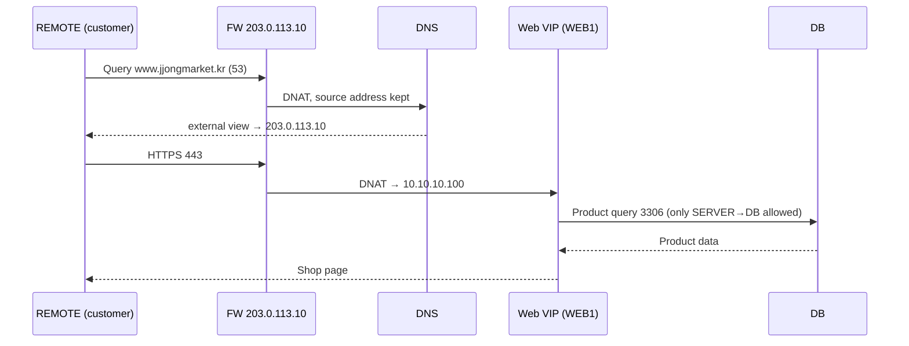
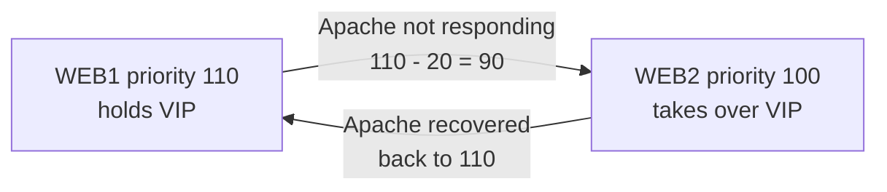

# JJongMarket IDC Lab

[한국어](../README.md) | **English** | [日本語](README.ja.md) | [简体中文](README.zh-CN.md) | [Español](README.es.md) | [Français](README.fr.md)

A project that builds an entire company infrastructure from scratch on 8 Debian VMs, based on the scenario that a fictional online shop, "JJongMarket", moves its servers from the cloud to an IDC (data center).


| Item | Details |
| --- | --- |
| Period | 2026.10.14 ~ 2026.10.27 |
| Team | 1 person (design, build, documentation) |
| Environment | VMware Workstation, Debian 13.2, 8 VMs (6 CLI servers, 2 GNOME clients) |
| Status | All 17 chapters built; verification and failure tests documented |

## Why I Started

During my field training (internship), I went to an IDC for the first time to install servers. Seeing web servers and a database actually separated behind a firewall felt very different from solving DNS, firewall, and VPN tasks one at a time in my skills-competition training. In a real company, all of these were tied together to run a single service.

So instead of installing services one by one, I decided to build one company's infrastructure myself, from planning all the way to failure testing.

While studying, I asked Claude about concepts and errors I didn't understand, and after understanding them, I typed the commands and configurations into the VMs myself to verify them. The day-by-day progress log is in [daily-log](../i18n/en/daily-log).

## Scenario

JJongMarket Inc. is an online shop with about 20 employees. As cloud costs kept rising, the company decided to rent an IDC rack and run its own servers, and I play the role of the infrastructure engineer.

| Requirement | Implementation |
| --- | --- |
| Access `https://www.jjongmarket.kr` from the internet | FW DNAT → web VIP → Apache |
| Keep the shop running even if one web server fails | keepalived VRRP, Apache health check |
| Open only the required ports | nftables default deny, allow list |
| Server management only from the management network; remote work via VPN | WireGuard; VPN allowed only to MGMT ports 22·443 |
| Answer with internal addresses inside and public addresses outside | BIND9 views (split-horizon) |
| Back up product data | Daily dump, pulled to MGMT and stored separately |
| See server and service status on one screen | Prometheus, blackbox, Grafana |
| Let the next engineer rebuild the same environment | Per-chapter docs, Ansible |

## Topology


| Zone | Subnet | VMnet | VM |
| --- | --- | --- | --- |
| OUTSIDE | 203.0.113.0/24 | 0 | FW external NIC, REMOTE |
| SERVER | 10.10.10.0/24 | 1 | DNS .10, WEB1 .21, WEB2 .22, web VIP .100 |
| DB | 10.10.20.0/24 | 2 | DB .10 |
| MGMT | 10.10.30.0/24 | 3 | MGMT .10, CLIENT (DHCP) |
| VPN | 10.8.0.0/24 | - | FW .1, REMOTE .2 |

| VM | Role |
| --- | --- |
| FW | Router connecting 4 networks, nftables, DNAT, DHCP relay, WireGuard |
| DNS | BIND9 internal/external views, internal NTP server |
| WEB1 / WEB2 | Apache + PHP shop, keepalived, JJong LIVE streaming |
| DB | MariaDB, daily backup |
| MGMT | DHCP, Root CA, SSH CA, backup storage, Prometheus, Grafana, Ansible |
| CLIENT | In-house operator PC |
| REMOTE | Internet customer and remote administrator |

All VMs are connected only to host-only networks. The environment assumes no internet access; a NAT adapter was attached briefly only when installing packages and then removed.

## How It Works

### When a customer visits the shop



When the in-house CLIENT asks for the same name, the internal view answers `10.10.10.100` directly, so hairpin NAT is not needed.

### When a web server fails



keepalived checks `health.html` every 2 seconds. Both DNS and DNAT point to the VIP, and login sessions are stored in the DB, so logins and shopping carts are kept even when the server changes.

### When a remote administrator connects

REMOTE does not receive a gateway via DHCP, so there is no route to the internal network until the VPN is turned on. With the VPN on, only the `10.10.0.0/16` range goes through the tunnel (split tunnel), and the FW opens only MGMT ports 22 and 443 to the VPN range.

### JJong LIVE


I added a live-commerce page inside the shop. ffmpeg loops a 1-minute video at real playback speed, cuts it into 2-second HLS segments, and Apache serves them under `/hls/`. It uses `-c copy` without re-encoding, so CPU usage is almost zero, and because WEB1 and WEB2 each stream on their own, the broadcast continues even if one goes down.

## Build Order

Same order as the Session tab in my Notion. Each document contains only the per-device configuration commands; the original configuration files and deployment zips are in the [Resources](../Resources) folder.

| # | Chapter | Content |
| --- | --- | --- |
| 01 | [Basic Configuration](../i18n/en/Session/01-basic-configuration.md) | Common packages, hostnames |
| 02 | [IP Configuration](../i18n/en/Session/02-ip-configuration.md) | 4 FW NICs, `.254` gateway on each network |
| 03 | [IP Forwarding](../i18n/en/Session/03-ip-forwarding.md) | `ip_forward`, `rc.local` for reboots |
| 04 | [DHCP](../i18n/en/Session/04-dhcp.md) | MGMT DHCP server, FW dnsmasq relay |
| 05 | [Nftables](../i18n/en/Session/05-nftables.md) | Default drop, DNAT, MSS clamping |
| 06 | [Certificate Authority](../i18n/en/Session/06-certificate-authority.md) | Private Root CA, trusted on all devices |
| 07 | [DNS](../i18n/en/Session/07-dns.md) | internal / external views |
| 08 | [Wireguard](../i18n/en/Session/08-wireguard.md) | Split-tunnel VPN |
| 09 | [SSH](../i18n/en/Session/09-ssh.md) | root keys signed by an SSH CA |
| 10 | [Chrony](../i18n/en/Session/10-chrony.md) | DNS server as the internal time source |
| 11 | [MariaDB](../i18n/en/Session/11-mariadb.md) | bind-address, account access range limits |
| 12 | [Backup](../i18n/en/Session/12-backup.md) | Daily dump, rsync to MGMT |
| 13 | [Keepalived](../i18n/en/Session/13-keepalived.md) | VRRP, Apache health check |
| 14 | [WEB](../i18n/en/Session/14-web.md) | Apache + PHP shop, HTTPS |
| 15 | [Streaming](../i18n/en/Session/15-streaming.md) | ffmpeg HLS streaming |
| 16 | [Monitoring](../i18n/en/Session/16-monitoring.md) | node-exporter, blackbox, Prometheus, Grafana |
| 17 | [Ansible](../i18n/en/Session/17-ansible.md) | Common settings, web deployment automation |

## Verification and Failure Tests

After the build, I verified each chapter and caused failures on purpose to test whether the service stays up. Detailed commands and results are in [docs/verification.md](../i18n/en/docs/verification.md).

| Situation | Method | Result |
| --- | --- | --- |
| Web server Apache stopped | WEB1 `systemctl stop apache2` | WEB2 takes the VIP within seconds; login kept |
| Web server powered off | WEB1 `poweroff` | Shop stays up; Grafana shows WEB1 DOWN and a HostDown alert |
| Broadcast stopped | `systemctl stop jjonglive` | "Broadcast preparing" shown, LiveDown alert |
| DB dropped | `drop database shop` | Shop errors; restored from backup, 160 products recovered |
| Config changed | WEB2 `chmod 700 inc` | One `ansible-playbook` run restores it |
| Full reboot | `ansible 'all:!mgmt' -m reboot` | All services come back up automatically |

During verification I also found that the SSH CA private key had been copied to every server, and I documented the fix in the same document.

## Troubleshooting

I documented 10 problems I actually got stuck on, with screenshots, in [docs/troubleshooting.md](../i18n/en/docs/troubleshooting.md). Here are three memorable ones.

| | |
| --- | --- |
|  | **HTTP 500 error**<br>It worked when run as root but failed as www-data. The `inc` folder sent from Windows via scp had permission 700. |
|  | **All Korean text shown as boxes**<br>I thought it was an encoding problem, but CLIENT simply had no Korean font installed. |
|  | **Ansible stopped on WEB1**<br>The certificate path was different. Because the playbook checks files before overwriting settings, the shop was not affected. |

## The Shop

A practice shop built with PHP 8.4 and MariaDB. The company, products, and reviews are all fictional.

- 160 products (10 categories), 800 reviews, search and sorting
- Cart, shipping address and payment method input, orders, simulated delivery stages that change over time
- Product listing for sellers (image upload), card registration (Luhn check, only the last 4 digits stored, CVC never stored)
- Membership (JJong Club), JJong Delivery, ad pop-ups, JJong LIVE
- CSRF tokens, `password_hash`, DB sessions

Demo account: `demo@jjongmarket.kr` / `Jjong1234!`

## Folder Structure

```
JJongMarket-IDC-Lab/
├── README.md
├── Session/                  Chapters 01 ~ 17 configuration
├── Resources/
│   ├── jjong-idc-lab_*.zip   WEB, Streaming, Monitoring, Ansible deployment files
│   ├── configs/              Per-device configuration files
│   ├── ansible/              Playbooks (/etc/ansible)
│   ├── web/                  Shop PHP
│   ├── live/                 JJong LIVE video and source
│   └── scripts/              zip build scripts
├── docs/
│   ├── verification.md       Verification, failure tests, security review
│   ├── troubleshooting.md
│   └── images/
└── daily-log/                Day 01 ~ Day 10
```

Passwords are masked like `<ROOT_PASSWORD>` and `<VRRP_PASS>`. The DB account password `ChangeMe-Shop1` is an example value.

## Retrospective

The final result turned out quite different from the original plan. The VPN started with OpenVPN and switched to WireGuard for its simpler configuration, and the web, which I first imagined as an 8-product list page, grew into a shop with live streaming. Instead of attaching many exporters, checking whether the service responds from the customer's point of view with blackbox fit this setup better.

What I learned most was the process of tracking down errors. Reproducing the 500 error by switching the running user, and narrowing the broken Korean text down to a font problem, took far longer than solving competition tasks, but that's why it stuck with me. By making Ansible check every time for the permission issue and missing packages I had once gotten wrong by hand, I also felt firsthand why automation matters.

Remaining work:

| Current | Impact | Improvement |
| --- | --- | --- |
| 1 FW | All traffic stops if the FW fails | 2 FWs, keepalived, conntrackd |
| 1 DB (backup only) | Shop is down while restoring | MariaDB replication |
| 1 DNS | Name resolution fails | Secondary DNS |
| Grafana over http | Admin screen in plain text | https with the private CA certificate |
| Ansible covers only common settings and web | FW, DNS, DB rebuilt manually | Move to roles |
| Keys added with ssh-copy-id | Access path that bypasses the CA | Access only with CA-signed keys |

## License

[MIT](../LICENSE)
