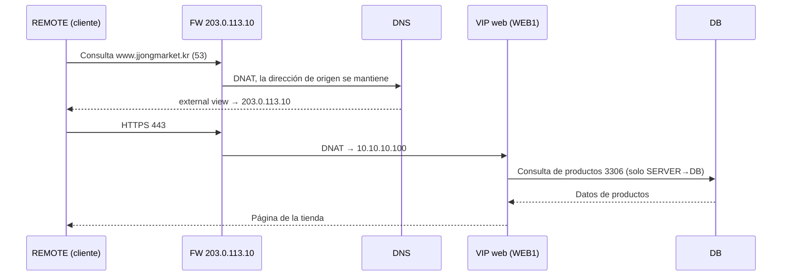
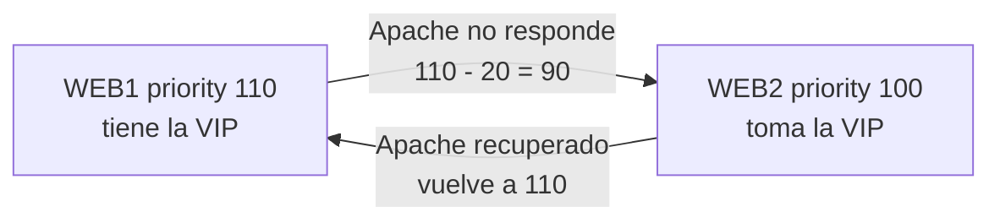

# JJongMarket IDC Lab

[한국어](../README.md) | [English](README.en.md) | [日本語](README.ja.md) | [简体中文](README.zh-CN.md) | **Español** | [Français](README.fr.md)

Un proyecto en el que construí desde cero, en 8 VM Debian, la infraestructura completa de una empresa, con el escenario de que una tienda online ficticia, "JJongMarket", traslada sus servidores de la nube a un IDC (centro de datos).


| Elemento | Detalle |
| --- | --- |
| Periodo | 2026.10.14 ~ 2026.10.27 |
| Equipo | 1 persona (diseño, construcción, documentación) |
| Entorno | VMware Workstation, Debian 13.2, 8 VM (6 servidores CLI, 2 clientes GNOME) |
| Estado | Los 17 capítulos construidos; verificación y pruebas de fallos documentadas |

## Por qué empecé

Durante mis prácticas fui por primera vez a un IDC a instalar servidores. Ver los servidores web y la base de datos realmente separados detrás de un firewall fue muy distinto de resolver DNS, firewall y VPN como ejercicios sueltos en el entrenamiento para la competición de habilidades. En una empresa real, todo eso funcionaba unido para dar un único servicio.

Así que, en lugar de instalar servicios uno a uno, decidí construir yo mismo la infraestructura de una empresa, desde la planificación hasta las pruebas de fallos.

Mientras estudiaba, le preguntaba a Claude los conceptos y errores que no entendía y, una vez comprendidos, escribía yo mismo los comandos y configuraciones en las VM para comprobarlos. El registro diario de avances está en [daily-log](../i18n/es/daily-log).

## Escenario

JJongMarket S.A. es una tienda online de unos 20 empleados. Como el coste de la nube no paraba de crecer, decidió alquilar un rack en un IDC y gestionar sus propios servidores; yo hago el papel de responsable de infraestructura.

| Requisito | Implementación |
| --- | --- |
| Acceder a `https://www.jjongmarket.kr` desde internet | FW DNAT → VIP web → Apache |
| Mantener la tienda aunque falle un servidor web | keepalived VRRP, comprobación de Apache |
| Abrir solo los puertos necesarios | nftables con bloqueo por defecto, lista de permitidos |
| Gestión de servidores solo desde la red de gestión; teletrabajo por VPN | WireGuard; la VPN solo permite MGMT 22·443 |
| Responder con direcciones internas dentro y públicas fuera | BIND9 view (split-horizon) |
| Copia de seguridad de los datos de productos | Volcado diario, recogido por MGMT y guardado aparte |
| Ver el estado de servidores y servicios en una pantalla | Prometheus, blackbox, Grafana |
| Que el siguiente responsable pueda reconstruir el mismo entorno | Documentación por capítulos, Ansible |

## Topología


| Zona | Red | VMnet | VM |
| --- | --- | --- | --- |
| OUTSIDE | 203.0.113.0/24 | 0 | NIC externa del FW, REMOTE |
| SERVER | 10.10.10.0/24 | 1 | DNS .10, WEB1 .21, WEB2 .22, VIP web .100 |
| DB | 10.10.20.0/24 | 2 | DB .10 |
| MGMT | 10.10.30.0/24 | 3 | MGMT .10, CLIENT (DHCP) |
| VPN | 10.8.0.0/24 | - | FW .1, REMOTE .2 |

| VM | Función |
| --- | --- |
| FW | Router que une las 4 redes, nftables, DNAT, relé DHCP, WireGuard |
| DNS | BIND9 con view interna y externa, servidor NTP interno |
| WEB1 / WEB2 | Tienda Apache + PHP, keepalived, emisión de JJong LIVE |
| DB | MariaDB, copia diaria |
| MGMT | DHCP, Root CA, SSH CA, almacén de copias, Prometheus, Grafana, Ansible |
| CLIENT | PC del operador interno |
| REMOTE | Cliente en internet y administrador en remoto |

Todas las VM están conectadas solo a redes Host-only. Se supone un entorno sin internet; el adaptador NAT solo se conectó un momento para instalar paquetes y luego se quitó.

## Cómo funciona

### Cuando un cliente entra en la tienda



Cuando el CLIENT interno pregunta por el mismo nombre, la internal view responde directamente `10.10.10.100`, así que no hace falta hairpin NAT.

### Cuando falla un servidor web



keepalived comprueba `health.html` cada 2 segundos. El DNS y el DNAT apuntan a la VIP y las sesiones se guardan en la BD, así que la sesión iniciada y el carrito se mantienen aunque cambie el servidor.

### Cuando se conecta un administrador en remoto

REMOTE no recibe puerta de enlace por DHCP, así que no tiene ruta a la red interna hasta activar la VPN. Con la VPN activa, solo el rango `10.10.0.0/16` va por el túnel (split tunnel), y el FW solo abre a la red VPN los puertos 22 y 443 de MGMT.

### JJong LIVE


Añadí una página de comercio en directo dentro de la tienda. ffmpeg repite en bucle un vídeo de 1 minuto a velocidad real, lo corta en segmentos HLS de 2 segundos y Apache los sirve en `/hls/`. Usa `-c copy` sin recodificar, así que casi no consume CPU, y como WEB1 y WEB2 emiten cada uno por su cuenta, la emisión continúa aunque se apague uno.

## Orden de construcción

Es el mismo orden que organicé en la pestaña Session de Notion. Cada documento contiene solo los comandos de configuración de cada equipo; los archivos de configuración originales y los zip de despliegue están en la carpeta [Resources](../Resources).

| # | Capítulo | Contenido |
| --- | --- | --- |
| 01 | [Basic Configuration](../i18n/es/Session/01-basic-configuration.md) | Paquetes comunes, nombres de host |
| 02 | [IP Configuration](../i18n/es/Session/02-ip-configuration.md) | 4 NIC del FW, puerta de enlace `.254` en cada red |
| 03 | [IP Forwarding](../i18n/es/Session/03-ip-forwarding.md) | `ip_forward`, `rc.local` para los reinicios |
| 04 | [DHCP](../i18n/es/Session/04-dhcp.md) | Servidor DHCP en MGMT, relé dnsmasq en el FW |
| 05 | [Nftables](../i18n/es/Session/05-nftables.md) | Drop por defecto, DNAT, MSS clamping |
| 06 | [Certificate Authority](../i18n/es/Session/06-certificate-authority.md) | Root CA privada, de confianza en todos los equipos |
| 07 | [DNS](../i18n/es/Session/07-dns.md) | internal / external view |
| 08 | [Wireguard](../i18n/es/Session/08-wireguard.md) | VPN split tunnel |
| 09 | [SSH](../i18n/es/Session/09-ssh.md) | Claves de root firmadas por una SSH CA |
| 10 | [Chrony](../i18n/es/Session/10-chrony.md) | El servidor DNS como referencia horaria interna |
| 11 | [MariaDB](../i18n/es/Session/11-mariadb.md) | bind-address, límite de redes de acceso por cuenta |
| 12 | [Backup](../i18n/es/Session/12-backup.md) | Volcado diario, rsync a MGMT |
| 13 | [Keepalived](../i18n/es/Session/13-keepalived.md) | VRRP, comprobación de Apache |
| 14 | [WEB](../i18n/es/Session/14-web.md) | Tienda Apache + PHP, HTTPS |
| 15 | [Streaming](../i18n/es/Session/15-streaming.md) | Emisión HLS con ffmpeg |
| 16 | [Monitoring](../i18n/es/Session/16-monitoring.md) | node-exporter, blackbox, Prometheus, Grafana |
| 17 | [Ansible](../i18n/es/Session/17-ansible.md) | Configuración común, automatización del despliegue web |

## Verificación y pruebas de fallos

Al terminar, comprobé el funcionamiento capítulo a capítulo y provoqué fallos a propósito para ver si el servicio se mantenía. Los comandos y resultados detallados están en [docs/verification.md](../i18n/es/docs/verification.md).

| Situación | Método | Resultado |
| --- | --- | --- |
| Apache del servidor web parado | WEB1 `systemctl stop apache2` | En segundos WEB2 toma la VIP y la sesión se mantiene |
| Servidor web apagado | WEB1 `poweroff` | La tienda sigue abierta; Grafana muestra WEB1 DOWN y la alerta HostDown |
| Emisión parada | `systemctl stop jjonglive` | Aparece "Preparando la emisión", alerta LiveDown |
| BD borrada | `drop database shop` | La tienda da error; restaurada desde la copia, 160 productos recuperados |
| Configuración cambiada | WEB2 `chmod 700 inc` | Una ejecución de `ansible-playbook` lo deja como estaba |
| Reinicio completo | `ansible 'all:!mgmt' -m reboot` | Todos los servicios vuelven a levantarse solos |

Durante la verificación también descubrí que la clave privada de la SSH CA se había copiado a todos los servidores, y dejé la solución en el mismo documento.

## Resolución de problemas

Documenté en [docs/troubleshooting.md](../i18n/es/docs/troubleshooting.md), con capturas, 10 problemas en los que me atasqué de verdad. Estos son los tres que más recuerdo.

| | |
| --- | --- |
|  | **Error 500**<br>Funcionaba al ejecutarlo como root pero fallaba como www-data. La carpeta `inc` enviada desde Windows con scp tenía permisos 700. |
|  | **Todo el coreano aparecía como cuadrados**<br>Creía que era un problema de codificación, pero CLIENT no tenía instalada ninguna fuente coreana. |
|  | **Ansible se detuvo en WEB1**<br>La ruta del certificado era distinta. Como el playbook comprueba los archivos antes de sobrescribir la configuración, la tienda no se vio afectada. |

## La tienda

Una tienda de prácticas hecha con PHP 8.4 y MariaDB. La empresa, los productos y las reseñas son ficticios.

- 160 productos (10 categorías), 800 reseñas, búsqueda y ordenación
- Carrito, dirección de envío y método de pago, pedidos, fases de envío simuladas que cambian con el tiempo
- Publicación de productos (subida de imágenes), registro de tarjetas (comprobación de Luhn, solo se guardan los 4 últimos dígitos, el CVC nunca se guarda)
- Membresía (JJong Club), Envío JJong, ventanas emergentes de publicidad, JJong LIVE
- Tokens CSRF, `password_hash`, sesiones en la BD

Cuenta de demostración: `demo@jjongmarket.kr` / `Jjong1234!`

## Estructura de carpetas

```
JJongMarket-IDC-Lab/
├── README.md
├── Session/                  Configuración de los capítulos 01 ~ 17
├── Resources/
│   ├── jjong-idc-lab_*.zip   Archivos de despliegue WEB, Streaming, Monitoring, Ansible
│   ├── configs/              Archivos de configuración por equipo
│   ├── ansible/              Playbooks (/etc/ansible)
│   ├── web/                  PHP de la tienda
│   ├── live/                 Vídeo de JJong LIVE y archivos fuente
│   └── scripts/              Scripts para generar los zip
├── docs/
│   ├── verification.md       Verificación, pruebas de fallos, revisión de seguridad
│   ├── troubleshooting.md
│   └── images/
└── daily-log/                Day 01 ~ Day 10
```

Las contraseñas están ocultas como `<ROOT_PASSWORD>` y `<VRRP_PASS>`. La contraseña de la cuenta de la BD `ChangeMe-Shop1` es un valor de ejemplo.

## Retrospectiva

El resultado final acabó siendo bastante distinto del plan inicial. La VPN empezó con OpenVPN y pasó a WireGuard por su configuración más sencilla, y la web, que imaginaba como una lista de 8 productos, creció hasta convertirse en una tienda con emisión en directo. En vez de añadir muchos exporters, comprobar con blackbox si el servicio responde desde el punto de vista del cliente encajaba mejor con esta arquitectura.

Lo que más aprendí fue el proceso de rastrear errores. Reproducir el error 500 cambiando el usuario de ejecución y acotar el coreano roto hasta descubrir que era un problema de fuentes me llevó mucho más tiempo que resolver ejercicios de competición, pero precisamente por eso se me quedó grabado. Al hacer que Ansible compruebe cada vez el problema de permisos y los paquetes que faltaban, errores que cometí una vez a mano, también entendí de primera mano por qué se automatiza.

Tareas pendientes:

| Actual | Impacto | Mejora |
| --- | --- | --- |
| 1 FW | Si cae el FW, se corta todo el tráfico | 2 FW, keepalived, conntrackd |
| 1 BD (solo copias) | La tienda se detiene durante la restauración | Replicación de MariaDB |
| 1 DNS | No se pueden resolver nombres | DNS secundario |
| Grafana por http | Pantalla de administración en texto plano | https con el certificado de la CA privada |
| Ansible solo cubre la configuración común y la web | FW, DNS y BD se reconstruyen a mano | Migrar a roles |
| Claves añadidas con ssh-copy-id | Ruta de acceso que no pasa por la CA | Acceso solo con claves firmadas por la CA |

## License

[MIT](../LICENSE)
