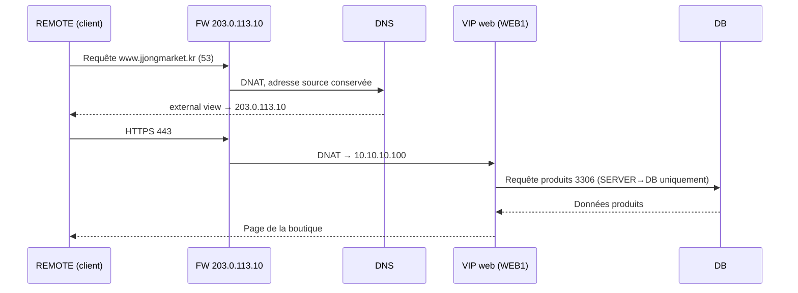
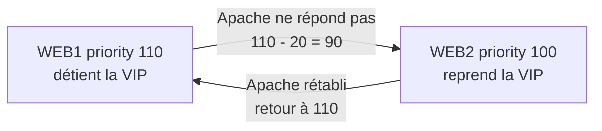

# JJongMarket IDC Lab

[한국어](../README.md) | [English](README.en.md) | [日本語](README.ja.md) | [简体中文](README.zh-CN.md) | [Español](README.es.md) | **Français**

Un projet où j'ai construit de A à Z l'infrastructure complète d'une entreprise sur 8 VM Debian, avec pour scénario une boutique en ligne fictive, « JJongMarket », qui déménage ses serveurs du cloud vers un IDC (centre de données).


| Élément | Détail |
| --- | --- |
| Période | 2026.10.14 ~ 2026.10.27 |
| Équipe | 1 personne (conception, construction, documentation) |
| Environnement | VMware Workstation, Debian 13.2, 8 VM (6 serveurs CLI, 2 clients GNOME) |
| État | Les 17 chapitres construits ; vérifications et tests de panne documentés |

## Pourquoi ce projet

Pendant mon stage, je suis allé pour la première fois dans un IDC pour installer des serveurs. Voir réellement les serveurs web et la base de données séparés derrière un pare-feu m'a fait un tout autre effet que de traiter DNS, pare-feu et VPN comme des exercices isolés pendant mon entraînement aux concours de compétences. Dans une vraie entreprise, tout cela fonctionnait ensemble au service d'un seul service.

Alors, au lieu d'installer les services un par un, j'ai décidé de construire moi-même l'infrastructure d'une entreprise, de la planification jusqu'aux tests de panne.

Pendant mon apprentissage, j'ai posé à Claude des questions sur les notions et les erreurs que je ne comprenais pas, puis, une fois compris, j'ai tapé moi-même les commandes et les configurations dans les VM pour les vérifier. Le journal de progression jour par jour se trouve dans [daily-log](../i18n/fr/daily-log).

## Scénario

JJongMarket SA est une boutique en ligne d'une vingtaine d'employés. Comme les coûts du cloud ne cessaient d'augmenter, elle a décidé de louer une baie dans un IDC et d'exploiter ses propres serveurs ; je joue le rôle du responsable de l'infrastructure.

| Exigence | Mise en œuvre |
| --- | --- |
| Accéder à `https://www.jjongmarket.kr` depuis Internet | FW DNAT → VIP web → Apache |
| Garder la boutique en ligne même si un serveur web tombe | keepalived VRRP, contrôle de santé d'Apache |
| N'ouvrir que les ports nécessaires | nftables avec blocage par défaut, liste d'autorisations |
| Administration uniquement depuis le réseau de gestion ; télétravail via VPN | WireGuard ; le VPN n'autorise que MGMT 22·443 |
| Répondre avec des adresses internes à l'intérieur et publiques à l'extérieur | BIND9 view (split-horizon) |
| Sauvegarder les données produits | Dump quotidien, récupéré par MGMT et stocké à part |
| Voir l'état des serveurs et des services sur un seul écran | Prometheus, blackbox, Grafana |
| Permettre au prochain responsable de reconstruire le même environnement | Documentation par chapitre, Ansible |

## Topologie


| Zone | Réseau | VMnet | VM |
| --- | --- | --- | --- |
| OUTSIDE | 203.0.113.0/24 | 0 | Carte externe du FW, REMOTE |
| SERVER | 10.10.10.0/24 | 1 | DNS .10, WEB1 .21, WEB2 .22, VIP web .100 |
| DB | 10.10.20.0/24 | 2 | DB .10 |
| MGMT | 10.10.30.0/24 | 3 | MGMT .10, CLIENT (DHCP) |
| VPN | 10.8.0.0/24 | - | FW .1, REMOTE .2 |

| VM | Rôle |
| --- | --- |
| FW | Routeur reliant les 4 réseaux, nftables, DNAT, relais DHCP, WireGuard |
| DNS | BIND9 avec view interne et externe, serveur NTP interne |
| WEB1 / WEB2 | Boutique Apache + PHP, keepalived, diffusion JJong LIVE |
| DB | MariaDB, sauvegarde quotidienne |
| MGMT | DHCP, Root CA, SSH CA, stockage des sauvegardes, Prometheus, Grafana, Ansible |
| CLIENT | PC de l'opérateur interne |
| REMOTE | Client sur Internet et administrateur en télétravail |

Toutes les VM sont reliées uniquement à des réseaux Host-only. L'environnement est supposé sans Internet ; un adaptateur NAT n'a été branché que brièvement pour installer des paquets, puis retiré.

## Fonctionnement

### Quand un client visite la boutique



Quand le CLIENT interne demande le même nom, l'internal view répond directement `10.10.10.100` : pas besoin de NAT en épingle (hairpin NAT).

### Quand un serveur web tombe en panne



keepalived vérifie `health.html` toutes les 2 secondes. Le DNS et le DNAT pointent tous deux vers la VIP, et les sessions sont stockées dans la base : la connexion et le panier sont donc conservés même quand le serveur change.

### Quand un administrateur se connecte à distance

REMOTE ne reçoit pas de passerelle par DHCP : il n'a donc aucune route vers le réseau interne tant que le VPN n'est pas activé. VPN activé, seule la plage `10.10.0.0/16` passe par le tunnel (split tunnel), et le FW n'ouvre à la plage VPN que les ports 22 et 443 de MGMT.

### JJong LIVE


J'ai ajouté une page de vente en direct dans la boutique. ffmpeg lit en boucle une vidéo d'1 minute à vitesse réelle, la découpe en segments HLS de 2 secondes, et Apache les sert sur `/hls/`. Avec `-c copy`, sans réencodage, l'utilisation CPU est quasi nulle ; et comme WEB1 et WEB2 diffusent chacun de leur côté, la diffusion continue même si l'un s'éteint.

## Ordre de construction

Le même ordre que dans l'onglet Session de mon Notion. Chaque document ne contient que les commandes de configuration par équipement ; les fichiers de configuration d'origine et les zip de déploiement se trouvent dans le dossier [Resources](../Resources).

| # | Chapitre | Contenu |
| --- | --- | --- |
| 01 | [Basic Configuration](../i18n/fr/Session/01-basic-configuration.md) | Paquets communs, noms d'hôte |
| 02 | [IP Configuration](../i18n/fr/Session/02-ip-configuration.md) | 4 cartes réseau du FW, passerelle `.254` sur chaque réseau |
| 03 | [IP Forwarding](../i18n/fr/Session/03-ip-forwarding.md) | `ip_forward`, `rc.local` pour les redémarrages |
| 04 | [DHCP](../i18n/fr/Session/04-dhcp.md) | Serveur DHCP sur MGMT, relais dnsmasq sur le FW |
| 05 | [Nftables](../i18n/fr/Session/05-nftables.md) | Drop par défaut, DNAT, MSS clamping |
| 06 | [Certificate Authority](../i18n/fr/Session/06-certificate-authority.md) | Root CA privée, approuvée sur tous les équipements |
| 07 | [DNS](../i18n/fr/Session/07-dns.md) | internal / external view |
| 08 | [Wireguard](../i18n/fr/Session/08-wireguard.md) | VPN split tunnel |
| 09 | [SSH](../i18n/fr/Session/09-ssh.md) | Clés root signées par une SSH CA |
| 10 | [Chrony](../i18n/fr/Session/10-chrony.md) | Le serveur DNS comme référence de temps interne |
| 11 | [MariaDB](../i18n/fr/Session/11-mariadb.md) | bind-address, restriction des réseaux d'accès par compte |
| 12 | [Backup](../i18n/fr/Session/12-backup.md) | Dump quotidien, rsync vers MGMT |
| 13 | [Keepalived](../i18n/fr/Session/13-keepalived.md) | VRRP, contrôle de santé d'Apache |
| 14 | [WEB](../i18n/fr/Session/14-web.md) | Boutique Apache + PHP, HTTPS |
| 15 | [Streaming](../i18n/fr/Session/15-streaming.md) | Diffusion HLS avec ffmpeg |
| 16 | [Monitoring](../i18n/fr/Session/16-monitoring.md) | node-exporter, blackbox, Prometheus, Grafana |
| 17 | [Ansible](../i18n/fr/Session/17-ansible.md) | Configuration commune, automatisation du déploiement web |

## Vérifications et tests de panne

Une fois la construction terminée, j'ai vérifié le fonctionnement chapitre par chapitre et provoqué volontairement des pannes pour voir si le service tenait. Les commandes et résultats détaillés sont dans [docs/verification.md](../i18n/fr/docs/verification.md).

| Situation | Méthode | Résultat |
| --- | --- | --- |
| Apache arrêté sur un serveur web | WEB1 `systemctl stop apache2` | WEB2 reprend la VIP en quelques secondes ; la session est conservée |
| Serveur web éteint | WEB1 `poweroff` | La boutique reste accessible ; Grafana affiche WEB1 DOWN et l'alerte HostDown |
| Diffusion arrêtée | `systemctl stop jjonglive` | Affiche « Diffusion en préparation », alerte LiveDown |
| Base supprimée | `drop database shop` | La boutique est en erreur ; restaurée depuis la sauvegarde, 160 produits récupérés |
| Configuration modifiée | WEB2 `chmod 700 inc` | Une exécution d'`ansible-playbook` remet tout en ordre |
| Redémarrage complet | `ansible 'all:!mgmt' -m reboot` | Tous les services redémarrent d'eux-mêmes |

Pendant les vérifications, j'ai aussi découvert que la clé privée de la SSH CA avait été copiée sur tous les serveurs ; la correction est décrite dans le même document.

## Dépannage

J'ai documenté avec captures d'écran, dans [docs/troubleshooting.md](../i18n/fr/docs/troubleshooting.md), 10 problèmes sur lesquels j'ai réellement bloqué. Voici les trois qui m'ont le plus marqué.

| | |
| --- | --- |
|  | **Erreur 500**<br>Tout fonctionnait en root mais échouait avec www-data. Le dossier `inc` envoyé depuis Windows par scp avait les permissions 700. |
|  | **Tout le coréen s'affichait en carrés**<br>Je pensais à un problème d'encodage, mais aucune police coréenne n'était installée sur CLIENT. |
|  | **Ansible s'est arrêté sur WEB1**<br>Le chemin du certificat était différent. Comme le playbook vérifie les fichiers avant d'écraser la configuration, la boutique n'a pas été touchée. |

## La boutique

Une boutique d'entraînement réalisée avec PHP 8.4 et MariaDB. L'entreprise, les produits et les avis sont tous fictifs.

- 160 produits (10 catégories), 800 avis, recherche et tri
- Panier, saisie de l'adresse de livraison et du moyen de paiement, commandes, étapes de livraison simulées qui évoluent avec le temps
- Mise en vente de produits (envoi d'images), enregistrement de carte (contrôle de Luhn, seuls les 4 derniers chiffres sont stockés, le CVC ne l'est jamais)
- Abonnement (JJong Club), Livraison JJong, pop-ups publicitaires, JJong LIVE
- Jetons CSRF, `password_hash`, sessions en base

Compte de démonstration : `demo@jjongmarket.kr` / `Jjong1234!`

## Arborescence

```
JJongMarket-IDC-Lab/
├── README.md
├── Session/                  Configuration des chapitres 01 ~ 17
├── Resources/
│   ├── jjong-idc-lab_*.zip   Fichiers de déploiement WEB, Streaming, Monitoring, Ansible
│   ├── configs/              Fichiers de configuration par équipement
│   ├── ansible/              Playbooks (/etc/ansible)
│   ├── web/                  PHP de la boutique
│   ├── live/                 Vidéo JJong LIVE et sources
│   └── scripts/              Scripts de génération des zip
├── docs/
│   ├── verification.md       Vérifications, tests de panne, revue de sécurité
│   ├── troubleshooting.md
│   └── images/
└── daily-log/                Day 01 ~ Day 10
```

Les mots de passe sont masqués sous la forme `<ROOT_PASSWORD>` et `<VRRP_PASS>`. Le mot de passe du compte de base de données `ChangeMe-Shop1` est une valeur d'exemple.

## Rétrospective

Le résultat final est assez différent du plan initial. Le VPN a commencé avec OpenVPN puis est passé à WireGuard pour sa configuration plus simple, et le site, que j'imaginais comme une liste de 8 produits, est devenu une boutique avec diffusion en direct. Plutôt que d'ajouter de nombreux exporters, vérifier avec blackbox si le service répond du point de vue du client convenait mieux à cette architecture.

Ce qui m'a le plus appris, c'est la traque des erreurs. Reproduire l'erreur 500 en changeant l'utilisateur d'exécution, puis réduire le problème du coréen cassé jusqu'à une question de police, m'a pris bien plus de temps que résoudre des exercices de concours, mais c'est justement pour cela que je m'en souviens. En faisant vérifier à chaque fois par Ansible le problème de permissions et les paquets manquants que j'avais une fois ratés à la main, j'ai aussi compris concrètement pourquoi on automatise.

Ce qu'il reste à faire :

| Actuel | Impact | Amélioration |
| --- | --- | --- |
| 1 FW | Si le FW tombe, tout le trafic s'arrête | 2 FW, keepalived, conntrackd |
| 1 base (sauvegardes seulement) | Boutique arrêtée pendant la restauration | Réplication MariaDB |
| 1 DNS | Résolution de noms impossible | DNS secondaire |
| Grafana en http | Écran d'administration en clair | https avec le certificat de la CA privée |
| Ansible ne couvre que la configuration commune et le web | FW, DNS et base reconstruits à la main | Passer aux roles |
| Clés ajoutées avec ssh-copy-id | Chemin d'accès qui contourne la CA | Accès uniquement avec des clés signées par la CA |

## License

[MIT](../LICENSE)
