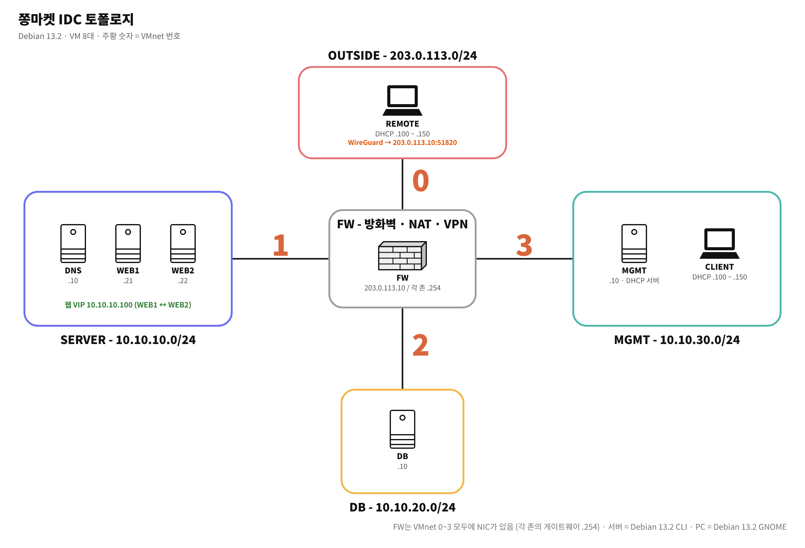
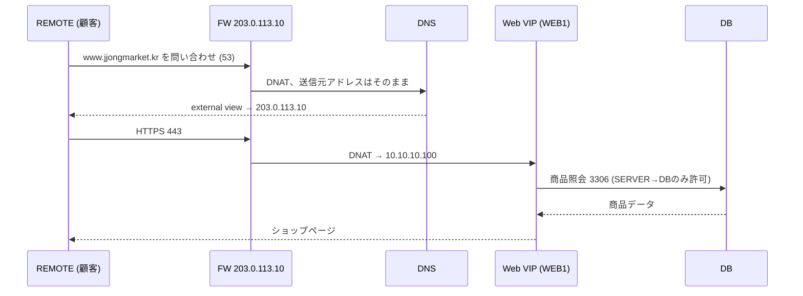
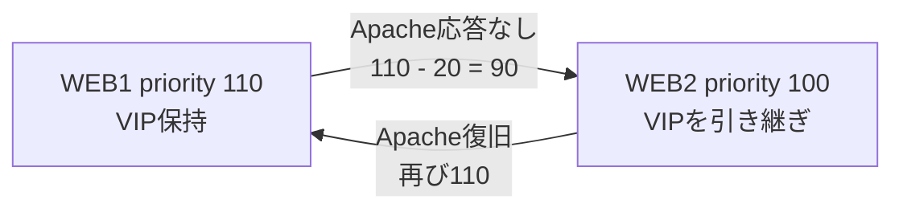

# JJongMarket IDC Lab

[한국어](../README.md) | [English](README.en.md) | **日本語** | [简体中文](README.zh-CN.md) | [Español](README.es.md) | [Français](README.fr.md)

架空のオンラインショップ「チョンマーケット(JJongMarket)」がクラウドからIDC(データセンター)へサーバーを移すという設定で、Debian VM 8台の上に一つの会社のインフラを最初から最後まで構築したプロジェクトです。


| 項目 | 内容 |
| --- | --- |
| 期間 | 2026.10.14 ~ 2026.10.27 |
| 人数 | 1名(設計、構築、ドキュメント作成) |
| 環境 | VMware Workstation、Debian 13.2、VM 8台(サーバー6台 CLI、クライアント2台 GNOME) |
| 状態 | 全17章の構築完了、点検と障害テストの整理完了 |

## きっかけ

現場実習(インターン)中に、初めてIDCへサーバーを設置しに行ったことがあります。ファイアウォールの後ろでWebサーバーとDBが分かれているのを実際に見て、技能五輪の訓練でDNS、ファイアウォール、VPNを課題ごとに別々に解いていたのとはまったく違う感覚でした。実際の会社では、これらすべてが一つのサービスのために結びついて動いていました。

そこで、サービスを一つずつインストールしてみるのではなく、一つの会社のインフラを企画から障害テストまで自分で作ってみることにしました。

勉強中にわからない概念やエラーはClaudeに質問して理解し、コマンドと設定は理解したうえでVMに自分で入力して確認しました。日ごとの進行記録は [daily-log](../i18n/ja/daily-log) にあります。

## シナリオ

(株)チョンマーケットは社員20名規模のオンラインショップです。クラウド費用が増え続けたため、IDCのラックを1つ借りてサーバーを自社運用することになり、私はインフラ担当者という設定です。

| 要件 | 実装 |
| --- | --- |
| インターネットから `https://www.jjongmarket.kr` にアクセス | FW DNAT → Web VIP → Apache |
| Webサーバーが1台故障してもショップを維持 | keepalived VRRP、Apacheヘルスチェック |
| 必要なポートだけを開放 | nftables デフォルト拒否、許可リスト |
| サーバー管理は管理網からのみ、在宅勤務はVPN | WireGuard、VPNはMGMTの22・443のみ許可 |
| 内部からは内部アドレス、外部からはグローバルアドレスで応答 | BIND9 view(split-horizon) |
| 商品データのバックアップ | 毎日ダンプ、MGMTへ取得して別途保管 |
| サーバーとサービスの状態を一画面で | Prometheus、blackbox、Grafana |
| 次の担当者が同じ環境を再構築できるように | 章ごとのドキュメント、Ansible |

## トポロジー



| ゾーン | 帯域 | VMnet | VM |
| --- | --- | --- | --- |
| OUTSIDE | 203.0.113.0/24 | 0 | FW 外部NIC、REMOTE |
| SERVER | 10.10.10.0/24 | 1 | DNS .10、WEB1 .21、WEB2 .22、Web VIP .100 |
| DB | 10.10.20.0/24 | 2 | DB .10 |
| MGMT | 10.10.30.0/24 | 3 | MGMT .10、CLIENT (DHCP) |
| VPN | 10.8.0.0/24 | - | FW .1、REMOTE .2 |

| VM | 役割 |
| --- | --- |
| FW | 4つのネットワークをつなぐルーター、nftables、DNAT、DHCPリレー、WireGuard |
| DNS | BIND9 内部・外部view、内部NTPサーバー |
| WEB1 / WEB2 | Apache + PHP ショップ、keepalived、チョンライブ配信 |
| DB | MariaDB、毎日バックアップ |
| MGMT | DHCP、Root CA、SSH CA、バックアップ保管、Prometheus、Grafana、Ansible |
| CLIENT | 社内オペレーターPC |
| REMOTE | インターネットの顧客 兼 在宅管理者 |

すべてのVMはHost-onlyネットワークにのみ接続しました。インターネットのない環境を想定し、パッケージをインストールするときだけNATアダプターを一時的に付けて外しました。

## 動作の流れ

### 顧客がショップにアクセスするとき



社内のCLIENTが同じ名前を問い合わせると、internal viewが `10.10.10.100` を直接返すため、ヘアピンNATは不要です。

### Webサーバーが故障したとき



keepalivedが2秒ごとに `health.html` を確認します。DNSとDNATはどちらもVIPを指しており、ログインセッションはDBに保存されるため、サーバーが切り替わってもログインとカートはそのまま維持されます。

### 在宅管理者が接続するとき

REMOTEはDHCPでゲートウェイを受け取らないため、VPNをオンにするまで内部網への経路がありません。VPNをオンにすると `10.10.0.0/16` 帯域だけがトンネルを通り(split tunnel)、FWはVPN帯域に対してMGMTの22、443ポートだけを開放します。

### チョンライブ(JJong LIVE)


ショップの中にライブコマースのページを1つ追加しました。1分間の動画をffmpegが実再生速度でループしながら2秒単位のHLSセグメントに分割し、Apacheが `/hls/` パスで配信します。再エンコードせず `-c copy` で処理するためCPU使用率はほぼゼロで、WEB1とWEB2がそれぞれ配信しているので、1台が停止しても配信は続きます。

## 構築手順

NotionのSessionタブにまとめた順序と同じです。各ドキュメントには機器ごとの設定コマンドのみがあり、設定ファイルの原本と配布用zipは [Resources](../Resources) フォルダーにあります。

| # | 章 | 内容 |
| --- | --- | --- |
| 01 | [Basic Configuration](../i18n/ja/Session/01-basic-configuration.md) | 共通パッケージ、ホスト名 |
| 02 | [IP Configuration](../i18n/ja/Session/02-ip-configuration.md) | FWの4つのNIC、各ネットワークの `.254` ゲートウェイ |
| 03 | [IP Forwarding](../i18n/ja/Session/03-ip-forwarding.md) | `ip_forward`、再起動に備えた `rc.local` |
| 04 | [DHCP](../i18n/ja/Session/04-dhcp.md) | MGMT DHCPサーバー、FW dnsmasqリレー |
| 05 | [Nftables](../i18n/ja/Session/05-nftables.md) | デフォルトdrop、DNAT、MSS clamping |
| 06 | [Certificate Authority](../i18n/ja/Session/06-certificate-authority.md) | プライベートRoot CA、全機器に信頼登録 |
| 07 | [DNS](../i18n/ja/Session/07-dns.md) | internal / external view |
| 08 | [Wireguard](../i18n/ja/Session/08-wireguard.md) | split tunnel VPN |
| 09 | [SSH](../i18n/ja/Session/09-ssh.md) | SSH CAで署名したrootキー |
| 10 | [Chrony](../i18n/ja/Session/10-chrony.md) | DNSサーバーを内部の時刻基準に |
| 11 | [MariaDB](../i18n/ja/Session/11-mariadb.md) | bind-address、アカウントの接続帯域制限 |
| 12 | [Backup](../i18n/ja/Session/12-backup.md) | 毎日ダンプ、MGMTへrsync |
| 13 | [Keepalived](../i18n/ja/Session/13-keepalived.md) | VRRP、Apacheヘルスチェック |
| 14 | [WEB](../i18n/ja/Session/14-web.md) | Apache + PHP ショップ、HTTPS |
| 15 | [Streaming](../i18n/ja/Session/15-streaming.md) | ffmpeg HLS配信 |
| 16 | [Monitoring](../i18n/ja/Session/16-monitoring.md) | node-exporter、blackbox、Prometheus、Grafana |
| 17 | [Ansible](../i18n/ja/Session/17-ansible.md) | 共通設定、Webデプロイの自動化 |

## 点検と障害テスト

構築後に章ごとの動作を確認し、意図的に障害を起こしてサービスが維持されるかをテストしました。詳しいコマンドと結果は [docs/verification.md](../i18n/ja/docs/verification.md) にまとめています。

| 状況 | 方法 | 結果 |
| --- | --- | --- |
| WebサーバーのApache停止 | WEB1 `systemctl stop apache2` | 数秒以内にWEB2がVIPを引き継ぎ、ログイン維持 |
| Webサーバーの電源断 | WEB1 `poweroff` | ショップは表示され続け、GrafanaにWEB1 DOWN、HostDownアラート |
| 配信停止 | `systemctl stop jjonglive` | 「配信準備中」を表示、LiveDownアラート |
| DB削除 | `drop database shop` | ショップでエラー、バックアップから復元して商品160件を復旧 |
| 設定変更 | WEB2 `chmod 700 inc` | `ansible-playbook` 1回で元に戻る |
| 全体再起動 | `ansible 'all:!mgmt' -m reboot` | すべてのサービスが自動で再起動 |

点検中に、SSH CAの秘密鍵がすべてのサーバーにコピーされている問題も見つかり、その対処方法も同じドキュメントに記載しました。

## トラブルシューティング

構築中に実際に詰まった問題10件を、画面付きで [docs/troubleshooting.md](../i18n/ja/docs/troubleshooting.md) にまとめました。そのうち印象に残った3つです。

| | |
| --- | --- |
|  | **500エラー**<br>rootで実行すると正常なのに、www-dataで実行すると失敗しました。Windowsからscpで送った `inc` フォルダーの権限が700でした。 |
|  | **ハングルがすべて四角で表示**<br>エンコーディングの問題だと思っていましたが、CLIENTにハングルフォントがインストールされていませんでした。 |
|  | **AnsibleがWEB1で停止**<br>証明書のパスが違っていました。設定を上書きする前にファイルを確認するようにしていたため、ショップへの影響はありませんでした。 |

## ショップ

PHP 8.4とMariaDBで作った実習用ショップです。会社、商品、レビューはすべて架空のものです。

- 商品160件(10カテゴリー)、レビュー800件、検索と並び替え
- カート、配送先と支払い方法の入力、注文、時間とともに変わる仮想配送ステータス
- 出品(画像アップロード)、カード登録(Luhnチェック、下4桁のみ保存、CVCは保存しない)
- メンバーシップ(チョンクラブ)、チョン配送、広告ポップアップ、チョンライブ
- CSRFトークン、`password_hash`、DBセッション

デモアカウント: `demo@jjongmarket.kr` / `Jjong1234!`

## フォルダー構成

```
JJongMarket-IDC-Lab/
├── README.md
├── Session/                  01 ~ 17 章ごとの設定
├── Resources/
│   ├── jjong-idc-lab_*.zip   WEB、Streaming、Monitoring、Ansible 配布ファイル
│   ├── configs/              機器ごとの設定ファイル
│   ├── ansible/              プレイブック (/etc/ansible)
│   ├── web/                  ショップ PHP
│   ├── live/                 チョンライブの動画と制作ソース
│   └── scripts/              zip 作成スクリプト
├── docs/
│   ├── verification.md       点検、障害テスト、セキュリティ点検
│   ├── troubleshooting.md
│   └── images/
└── daily-log/                Day 01 ~ Day 10
```

パスワードは `<ROOT_PASSWORD>`、`<VRRP_PASS>` のように伏せています。DBアカウントのパスワード `ChangeMe-Shop1` は例示用の値です。

## 振り返り

最初の計画と実際に作った結果はかなり違うものになりました。VPNはOpenVPNで始めましたが、設定がシンプルなWireGuardに切り替え、商品8件の一覧ページのつもりだったWebは、ショップとライブ配信にまで広がりました。exporterを複数付ける代わりに、blackboxで顧客の立場からサービスが応答しているかを確認するほうが、この構成には合っていました。

いちばん多くを学んだのは、エラーを追跡する過程でした。500エラーを実行ユーザーを変えながら再現し、ハングルの文字化けをフォントの問題へと絞り込んでいくなかで、課題を解くときよりも原因を探す時間のほうがはるかに長くかかりましたが、そのぶん記憶に残りました。手作業で一度ミスした権限の問題やパッケージの不足をAnsibleに毎回チェックさせるようにして、なぜ自動化するのかも実感しました。

残っている課題は以下のとおりです。

| 現在 | 影響 | 改善の方向 |
| --- | --- | --- |
| FW 1台 | FW障害時に全通信が停止 | FW 2台、keepalived、conntrackd |
| DB 1台(バックアップのみ) | 復元中はショップが停止 | MariaDBレプリケーション |
| DNS 1台 | 名前解決ができなくなる | セカンダリDNS |
| Grafana http | 管理画面が平文 | プライベートCA証明書でhttps化 |
| Ansibleは共通設定とWebのみ | FW、DNS、DBは手動で再構築 | roleへ移行 |
| ssh-copy-idで登録したキー | CAを経由しない接続経路 | CA証明書付きキーでのみ接続 |

## License

[MIT](../LICENSE)
