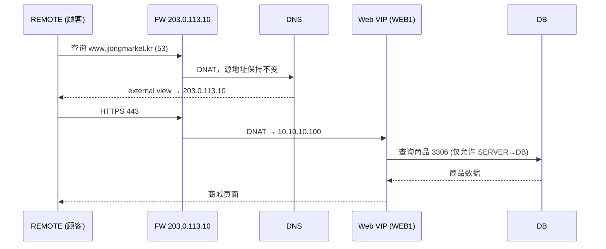
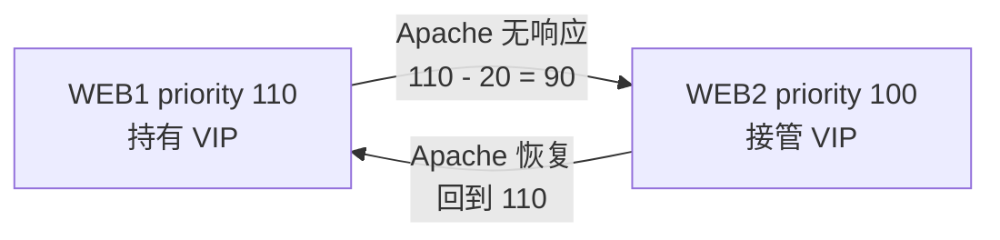

# JJongMarket IDC Lab

[한국어](../README.md) | [English](README.en.md) | [日本語](README.ja.md) | **简体中文** | [Español](README.es.md) | [Français](README.fr.md)

一个以虚构网上商城“JJongMarket(쫑마켓)”把服务器从云迁移到 IDC(数据中心)为背景，在 8 台 Debian VM 上从零到完整搭建一家公司基础设施的项目。


| 项目 | 内容 |
| --- | --- |
| 周期 | 2026.10.14 ~ 2026.10.27 |
| 人数 | 1 人(设计、搭建、文档) |
| 环境 | VMware Workstation、Debian 13.2、8 台 VM(6 台 CLI 服务器、2 台 GNOME 客户端) |
| 状态 | 17 个章节全部搭建完成，检查与故障测试整理完毕 |

## 项目缘起

实习期间，我第一次去 IDC 安装服务器。亲眼看到防火墙后面 Web 服务器和数据库被分开部署，感觉和在技能竞赛训练中把 DNS、防火墙、VPN 一题一题分别做完全不同。在真实的公司里，这些都是为了一项服务而连在一起运行的。

所以我决定不再一个个地安装服务，而是亲手搭建一家公司的基础设施，从规划一直做到故障测试。

学习过程中遇到不懂的概念和错误，我会向 Claude 提问来理解；命令和配置在理解之后亲手输入到 VM 中进行验证。按日期记录的进度见 [daily-log](../i18n/zh-CN/daily-log)。

## 场景

JJongMarket 股份有限公司是一家约 20 名员工的网上商城。由于云费用不断上涨，公司决定租用一个 IDC 机柜自行运营服务器，而我是基础设施负责人。

| 需求 | 实现 |
| --- | --- |
| 从互联网访问 `https://www.jjongmarket.kr` | FW DNAT → Web VIP → Apache |
| 一台 Web 服务器故障时商城仍可用 | keepalived VRRP、Apache 健康检查 |
| 只开放必要端口 | nftables 默认拒绝、白名单 |
| 服务器只能从管理网管理，远程办公走 VPN | WireGuard，VPN 只允许访问 MGMT 的 22·443 |
| 内部返回内网地址，外部返回公网地址 | BIND9 view(split-horizon) |
| 商品数据备份 | 每日转储，拉取到 MGMT 单独保存 |
| 在一个页面查看服务器和服务状态 | Prometheus、blackbox、Grafana |
| 让下一任负责人能重建同样的环境 | 分章节文档、Ansible |

## 拓扑


| 区域 | 网段 | VMnet | VM |
| --- | --- | --- | --- |
| OUTSIDE | 203.0.113.0/24 | 0 | FW 外网卡、REMOTE |
| SERVER | 10.10.10.0/24 | 1 | DNS .10、WEB1 .21、WEB2 .22、Web VIP .100 |
| DB | 10.10.20.0/24 | 2 | DB .10 |
| MGMT | 10.10.30.0/24 | 3 | MGMT .10、CLIENT (DHCP) |
| VPN | 10.8.0.0/24 | - | FW .1、REMOTE .2 |

| VM | 角色 |
| --- | --- |
| FW | 连接 4 个网络的路由器、nftables、DNAT、DHCP 中继、WireGuard |
| DNS | BIND9 内部·外部 view、内部 NTP 服务器 |
| WEB1 / WEB2 | Apache + PHP 商城、keepalived、JJong LIVE 直播 |
| DB | MariaDB、每日备份 |
| MGMT | DHCP、Root CA、SSH CA、备份存储、Prometheus、Grafana、Ansible |
| CLIENT | 公司内部运维人员电脑 |
| REMOTE | 互联网顾客兼远程管理员 |

所有 VM 只连接 Host-only 网络。假设没有互联网，只在安装软件包时临时挂上 NAT 网卡，装完即移除。

## 运行流程

### 顾客访问商城时



公司内部的 CLIENT 查询同一个名称时，internal view 会直接返回 `10.10.10.100`，因此不需要发夹 NAT(hairpin NAT)。

### Web 服务器故障时



keepalived 每 2 秒检查一次 `health.html`。DNS 和 DNAT 都指向 VIP，登录会话保存在数据库中，所以即使服务器切换，登录状态和购物车也会保留。

### 远程管理员接入时

REMOTE 不通过 DHCP 获取网关，所以在打开 VPN 之前没有通往内网的路由。打开 VPN 后，只有 `10.10.0.0/16` 网段走隧道(split tunnel)，FW 只为 VPN 网段开放 MGMT 的 22、443 端口。

### JJong LIVE


我在商城里加入了一个直播带货页面。ffmpeg 以实际播放速度不断循环一段 1 分钟的视频，切成 2 秒的 HLS 分片，由 Apache 通过 `/hls/` 路径对外提供。使用 `-c copy` 不重新编码，CPU 占用几乎为零；WEB1 和 WEB2 各自直播，其中一台关机直播也不会中断。

## 搭建顺序

与我在 Notion 的 Session 页签中整理的顺序相同。各文档只包含每台设备的配置命令，配置文件原件和部署用 zip 在 [Resources](../Resources) 文件夹中。

| # | 章节 | 内容 |
| --- | --- | --- |
| 01 | [Basic Configuration](../i18n/zh-CN/Session/01-basic-configuration.md) | 公共软件包、主机名 |
| 02 | [IP Configuration](../i18n/zh-CN/Session/02-ip-configuration.md) | FW 的 4 块网卡，各网段 `.254` 网关 |
| 03 | [IP Forwarding](../i18n/zh-CN/Session/03-ip-forwarding.md) | `ip_forward`，为重启准备的 `rc.local` |
| 04 | [DHCP](../i18n/zh-CN/Session/04-dhcp.md) | MGMT DHCP 服务器、FW dnsmasq 中继 |
| 05 | [Nftables](../i18n/zh-CN/Session/05-nftables.md) | 默认 drop、DNAT、MSS clamping |
| 06 | [Certificate Authority](../i18n/zh-CN/Session/06-certificate-authority.md) | 私有 Root CA，在所有设备上登记为受信任 |
| 07 | [DNS](../i18n/zh-CN/Session/07-dns.md) | internal / external view |
| 08 | [Wireguard](../i18n/zh-CN/Session/08-wireguard.md) | split tunnel VPN |
| 09 | [SSH](../i18n/zh-CN/Session/09-ssh.md) | 用 SSH CA 签名的 root 密钥 |
| 10 | [Chrony](../i18n/zh-CN/Session/10-chrony.md) | 以 DNS 服务器作为内部时间基准 |
| 11 | [MariaDB](../i18n/zh-CN/Session/11-mariadb.md) | bind-address、限制账号访问网段 |
| 12 | [Backup](../i18n/zh-CN/Session/12-backup.md) | 每日转储，rsync 到 MGMT |
| 13 | [Keepalived](../i18n/zh-CN/Session/13-keepalived.md) | VRRP、Apache 健康检查 |
| 14 | [WEB](../i18n/zh-CN/Session/14-web.md) | Apache + PHP 商城、HTTPS |
| 15 | [Streaming](../i18n/zh-CN/Session/15-streaming.md) | ffmpeg HLS 直播 |
| 16 | [Monitoring](../i18n/zh-CN/Session/16-monitoring.md) | node-exporter、blackbox、Prometheus、Grafana |
| 17 | [Ansible](../i18n/zh-CN/Session/17-ansible.md) | 公共配置、Web 部署自动化 |

## 检查与故障测试

搭建完成后，我逐章确认了运行情况，并故意制造故障来测试服务能否保持。详细命令和结果整理在 [docs/verification.md](../i18n/zh-CN/docs/verification.md) 中。

| 情况 | 方法 | 结果 |
| --- | --- | --- |
| Web 服务器 Apache 停止 | WEB1 `systemctl stop apache2` | 几秒内 WEB2 接管 VIP，登录状态保持 |
| Web 服务器断电 | WEB1 `poweroff` | 商城仍可访问，Grafana 显示 WEB1 DOWN 并发出 HostDown 告警 |
| 直播中断 | `systemctl stop jjonglive` | 显示“直播准备中”，LiveDown 告警 |
| 删除数据库 | `drop database shop` | 商城报错，用备份恢复后 160 件商品复原 |
| 配置被改动 | WEB2 `chmod 700 inc` | 运行一次 `ansible-playbook` 即恢复原样 |
| 全部重启 | `ansible 'all:!mgmt' -m reboot` | 所有服务自动重新启动 |

检查时还发现 SSH CA 私钥被复制到了所有服务器上，处理方法也写在同一份文档里。

## 故障排查

搭建过程中实际卡住的 10 个问题，连同截图整理在 [docs/troubleshooting.md](../i18n/zh-CN/docs/troubleshooting.md) 中。下面是印象最深的三个。

| | |
| --- | --- |
|  | **500 错误**<br>用 root 运行正常，用 www-data 运行却失败。原来是从 Windows 用 scp 发送的 `inc` 文件夹权限为 700。 |
|  | **韩文全部显示为方块**<br>本以为是编码问题，结果是 CLIENT 没有安装韩文字体。 |
|  | **Ansible 在 WEB1 上中断**<br>证书路径不一致。因为预先让它在覆盖配置前先检查文件，商城没有受到影响。 |

## 商城

用 PHP 8.4 和 MariaDB 制作的练习用商城。公司、商品和评价全部是虚构的。

- 160 件商品(10 个分类)、800 条评价、搜索与排序
- 购物车、填写收货地址和支付方式、下单、随时间变化的模拟配送阶段
- 商品上架(上传图片)、银行卡登记(Luhn 校验，只保存后 4 位，不保存 CVC)
- 会员(JJong Club)、JJong 配送、广告弹窗、JJong LIVE
- CSRF 令牌、`password_hash`、数据库会话

演示账号: `demo@jjongmarket.kr` / `Jjong1234!`

## 目录结构

```
JJongMarket-IDC-Lab/
├── README.md
├── Session/                  01 ~ 17 各章节配置
├── Resources/
│   ├── jjong-idc-lab_*.zip   WEB、Streaming、Monitoring、Ansible 部署文件
│   ├── configs/              各设备配置文件
│   ├── ansible/              Playbook (/etc/ansible)
│   ├── web/                  商城 PHP
│   ├── live/                 JJong LIVE 视频与制作素材
│   └── scripts/              zip 生成脚本
├── docs/
│   ├── verification.md       检查、故障测试、安全检查
│   ├── troubleshooting.md
│   └── images/
└── daily-log/                Day 01 ~ Day 10
```

密码以 `<ROOT_PASSWORD>`、`<VRRP_PASS>` 的形式隐藏。数据库账号密码 `ChangeMe-Shop1` 只是示例值。

## 回顾

最初的计划和最终做出来的结果相差很大。VPN 一开始用 OpenVPN，后来换成了配置更简单的 WireGuard；原本设想成 8 件商品列表页的网站，最后扩展成了带直播的商城。与其挂很多 exporter，不如用 blackbox 从顾客的角度检查服务是否响应，这更适合这套架构。

收获最大的是追踪错误的过程。通过切换执行用户来复现 500 错误、把韩文乱码一步步缩小到字体问题，找原因花的时间比做题多得多，但也因此记得更牢。把手动操作时犯过的权限问题和缺失软件包交给 Ansible 每次检查之后，我也切身体会到了为什么要自动化。

仍待解决的问题如下。

| 现状 | 影响 | 改进方向 |
| --- | --- | --- |
| FW 1 台 | FW 故障时全部通信中断 | FW 2 台、keepalived、conntrackd |
| DB 1 台(只有备份) | 恢复期间商城停止服务 | MariaDB 复制 |
| DNS 1 台 | 无法解析域名 | secondary DNS |
| Grafana http | 管理界面为明文 | 用私有 CA 证书启用 https |
| Ansible 只覆盖公共配置和 Web | FW、DNS、DB 需手动重建 | 迁移为 role |
| 用 ssh-copy-id 添加的密钥 | 存在不经过 CA 的访问路径 | 只允许使用 CA 签名的密钥访问 |

## License

[MIT](../LICENSE)
