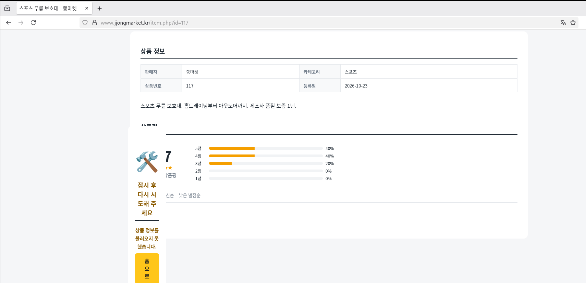
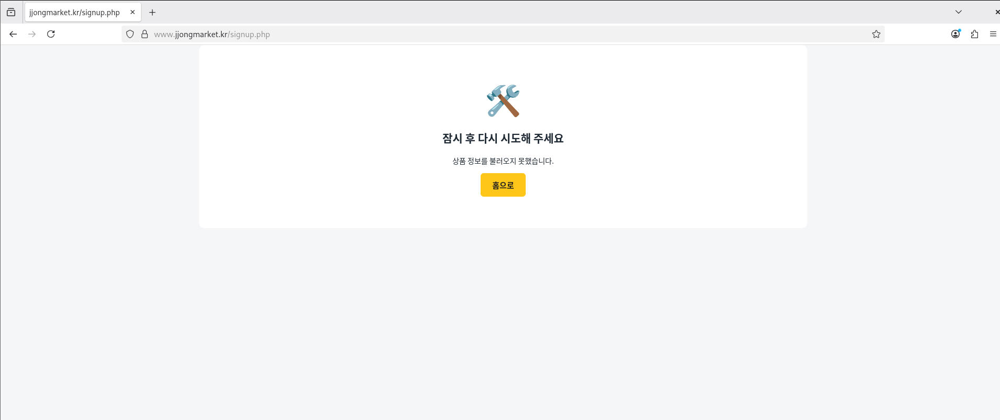
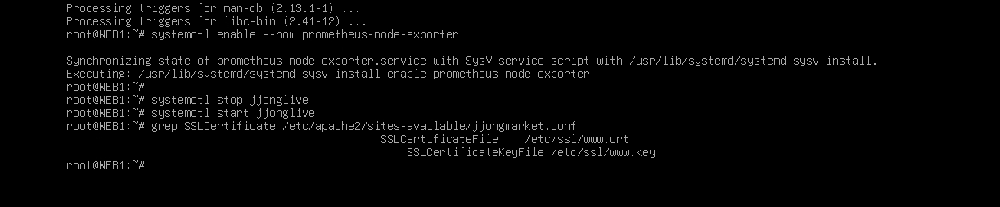

# Troubleshooting

[한국어](../../../docs/troubleshooting.md) | **English** | [日本語](../../ja/docs/troubleshooting.md) | [简体中文](../../zh-CN/docs/troubleshooting.md) | [Español](../../es/docs/troubleshooting.md) | [Français](../../fr/docs/troubleshooting.md)

Problems I actually got stuck on while building. Each is written as symptom, cause, fix, with the screenshots I took at the time.

| # | Symptom | Chapter |
| --- | --- | --- |
| 1 | [All Korean text in the shop shows as boxes](#1-all-korean-text-in-the-shop-shows-as-boxes) | WEB |
| 2 | [Korean text can't be pasted into the VMware console](#2-korean-text-cant-be-pasted-into-the-vmware-console) | All |
| 3 | [Config copied from Notion contains `<>`](#3-config-copied-from-notion-contains-) | Keepalived, WEB |
| 4 | [Indentation shifts like stairs when pasting into vim](#4-indentation-shifts-like-stairs-when-pasting-into-vim) | All |
| 5 | [500 Internal Server Error](#5-500-internal-server-error) | WEB |
| 6 | [Product detail page breaks and sign-up fails](#6-product-detail-page-breaks-and-sign-up-fails) | WEB |
| 7 | [All checkout fields are empty](#7-all-checkout-fields-are-empty) | WEB |
| 8 | [Ansible: everything except MGMT is UNREACHABLE](#8-ansible-everything-except-mgmt-is-unreachable) | Ansible |
| 9 | [Ansible stops on WEB1 (certificate path)](#9-ansible-stops-on-web1-certificate-path) | Ansible |
| 10 | [Notion 5MB upload limit](#10-notion-5mb-upload-limit) | File management |

---

### 1. All Korean text in the shop shows as boxes


- **Symptom**: The shop opens, but only the Korean text shows as boxes (□). Numbers, English, and the server name `WEB1` are fine.
- **Cause**: Not a server problem — CLIENT (Debian GNOME) had **no Korean font**. The HTML arrived correctly as UTF-8, but there was no font to draw it.
- **Fix**: Install fonts and an input method on CLIENT and REMOTE

  ```bash
  apt install -y fonts-noto-cjk ibus-hangul
  ```

- **Lesson**: First tell apart whether the "breakage" is an encoding problem or a font problem. If English and numbers are fine and there's exactly one box per Korean character, it's a font problem.

### 2. Korean text can't be pasted into the VMware console

- **Symptom**: Pasting configs that contain Korean, like Prometheus alert rules or the Grafana dashboard JSON, into the console makes the Korean parts disappear or break.
- **Cause**: The VMware console simulates keystrokes, so it doesn't support pasting Korean.
- **Fix**:
  - Files that really need Korean (JSON, SQL) are transferred **as files** with `scp` by briefly attaching a NAT adapter
  - Configs that must be typed in the console (rules-jjong.yml etc.) had their comments and text changed to English

### 3. Config copied from Notion contains `<>`

- **Symptom**: keepalived can't find the health-check script, and Apache `RewriteRule` behaves strangely.
- **Cause**: Notion auto-linked URLs outside code blocks, so when copied they came out wrapped in angle brackets like `<http://127.0.0.1/health.html>`.
- **Fix**: Remove the `<` `>` after pasting. Don't remove the `^` in `RewriteRule ^ https://...`.
- **Lesson**: Always keep configs inside code blocks before copying.

### 4. Indentation shifts like stairs when pasting into vim

- **Symptom**: When pasting YAML or conf, indentation accumulates on every line, and comments (`#`) spill onto the next line.
- **Cause**: `set si` (smartindent) in vimrc treats pasted characters as typing and auto-indents.
- **Fix**: `:set paste` before pasting, `:set nopaste` when done.

### 5. 500 Internal Server Error


- **Symptom**: After uploading the shop v2 files, the main page returned 500.
- **Tracing**: Works when run as root, fails when run as the Apache user (www-data).

  ```bash
  php index.php | head -5                          # works
  runuser -u www-data -- php index.php | head -5   # Permission denied
  ```

  

- **Cause**: The `inc` folder sent from Windows with `scp -r` had permission `drwx------` (700). www-data couldn't open `inc/app.php`.

  

- **Fix**:

  ```bash
  chmod -R a+rX /var/www/jjongmarket
  ```

  Capital `X` gives execute permission only to folders, so files become 644 and folders 755.
- **Prevention**: Ansible `web.yml` resets folders to 755 every time. In failure test T7, I deliberately changed it to 700 and confirmed it gets restored.

### 6. Product detail page breaks and sign-up fails

| Product detail | Sign-up |
| --- | --- |
|  |  |

- **Symptom**: An error box appears in the middle of the product detail page, and sign-up says "Please try again later".
- **Cause**: `php-mbstring` was not installed. `mb_strlen` and `mb_substr`, used for Korean name length checks and review trimming, were missing, so PHP stopped midway.
- **Fix**:

  ```bash
  apt install -y php-mbstring
  systemctl restart apache2
  ```

  I also added fallback functions to `inc/app.php` for when mbstring is missing, so pages don't die even if the package is absent.
- **Prevention**: Ansible checks that `php-mbstring` is installed.

### 7. All checkout fields are empty

- **Symptom**: The recipient and address on the checkout page should be pre-filled, but all are blank.
- **Cause**: The shared header `header.php` stored the flash message in the `$f` variable, and the checkout page also stored its input values in `$f`. Because of the include order, it got overwritten.
- **Fix**: Renamed the variable in `header.php` to `$flash_msg`.
- **Lesson**: PHP includes share variable scope. Avoid short variable names in shared files.

### 8. Ansible: everything except MGMT is UNREACHABLE

- **Symptom**: In `ansible-playbook site.yml`, only MGMT is ok and the other 5 are UNREACHABLE. Yet `ssh root@10.10.10.21 hostname` works fine.
- **Cause**: When ssh-ing by hand, a person typed the host key confirmation (yes) and the password, but Ansible can't do interactive input.
- **Fix**:

  ```bash
  ssh-keyscan 10.10.30.254 10.10.10.10 10.10.10.21 10.10.10.22 10.10.20.10 >> /root/.ssh/known_hosts
  ssh-keygen -t ed25519 -N "" -f /root/.ssh/id_ed25519
  ssh-copy-id root@<each server>
  ```

- **Remaining work**: This key bypasses the SSH CA. See [Verification - Security Review](verification.md#security-review).

### 9. Ansible stops on WEB1 (certificate path)


- **Symptom**: common.yml succeeds on all 6, but web.yml fails at `Required files exist` on WEB1.
- **Cause**: The playbook looked for the certificate at `/etc/ssl/jjong/www.jjongmarket.kr.crt`, but it was actually at `/etc/ssl/www.crt`.

  

- **Fix**: Changed the paths in `web.yml` and `files/jjongmarket.conf` to `/etc/ssl/www.crt` and `/etc/ssl/www.key`.
- **Lesson**: Without this check, Ansible would have overwritten Apache's config with one pointing to a nonexistent path, and the shop would have died on the next restart. Thanks to `serial: 1`, it stopped on WEB1 and never touched WEB2. Making it check preconditions before overwriting settings paid off.

### 10. Notion 5MB upload limit

- **Symptom**: The JJong LIVE video and the Grafana package couldn't be uploaded to Notion Resources.
- **Fix**:
  - Re-encoded the video with `crf 27`, `-preset veryslow`, `-tune animation` to bring 1 minute down to 3.6MB
  - Split the Grafana deb into 4MB parts and used `Get-FileHash` to confirm the rejoined file matches the original
