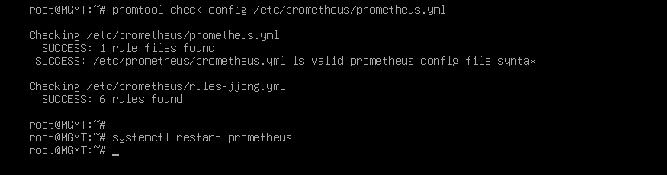

# Verification

[한국어](../../../docs/verification.md) | **English** | [日本語](../../ja/docs/verification.md) | [简体中文](../../zh-CN/docs/verification.md) | [Español](../../es/docs/verification.md) | [Français](../../fr/docs/verification.md)

How each chapter actually behaves when you follow the Configuration from the start, and how to see it with your own eyes.
Under each command is the result you should see when things are normal. Ansible commands under `[ MGMT ]` are run from `/etc/ansible`.

- [Per-chapter checks](#per-chapter-checks)
- [Failure tests](#failure-tests)
- [Security review](#security-review)

## Per-chapter checks

### Basic Configuration

```bash
# [ MGMT ]
ansible all -a hostname
```
FW, DNS, WEB1, WEB2, DB and MGMT each print their own name from their own machine.

### IP Configuration

The FW straddles all 4 networks, so all traffic that crosses networks passes through the FW.

```bash
# [ FW ]
ip -br a            # ens33 203.0.113.10 / ens37 10.10.10.254 / ens38 10.10.20.254 / ens39 10.10.30.254
# [ DB ]
ip route            # default via 10.10.20.254
# [ MGMT ]
ping -c 2 10.10.20.10     # replies (FW allows everything from the MGMT network)
```

### IP Forwarding

```bash
# [ FW ]
sysctl net.ipv4.ip_forward     # = 1
systemctl status rc-local      # active (exited)
```
It must still be 1 after a reboot. Checked together in failure test T9.

### DHCP

```bash
# [ CLIENT ]
ip -br a ; ip route        # 10.10.30.1xx, default via 10.10.30.254
# [ REMOTE ]
ip -br a ; ip route        # 203.0.113.1xx, no default
# [ MGMT ]
journalctl -u isc-dhcp-server | grep DHCPACK
```
The REMOTE log shows `via 203.0.113.10`. That means it came through the FW's relay.

### Nftables

```bash
# [ REMOTE ] VPN off
nmap -Pn 203.0.113.10          # only 53, 80, 443 open
# [ WEB1 ]
nmap -Pn -p 3306 10.10.20.10   # open
nmap -Pn -p 22 10.10.30.10     # filtered
```
Even if the web server is compromised, it can only reach DB's 3306 and can't cross into the management network.
forward has no icmp allow rule, so pings across networks are blocked except from MGMT. That's why the checks are done per port.

### Certificate Authority

```bash
# [ MGMT ]
openssl verify -CAfile /etc/ssl/RootCA.crt /etc/ssl/www.crt     # www.crt: OK
# [ CLIENT ]
curl -sI https://www.jjongmarket.kr | head -1                  # HTTP/1.1 200 (without -k)
```

### DNS

```bash
# [ DNS ]
named-checkconf
# [ CLIENT ]
dig www.jjongmarket.kr +short                    # 10.10.10.100
dig -x 10.10.10.21 +short                        # web1.jjong.internal.
# [ REMOTE ] VPN off
dig @203.0.113.10 www.jjongmarket.kr +short      # 203.0.113.10
dig @203.0.113.10 ns.jjong.internal              # status: REFUSED
# [ REMOTE ] VPN on
dig www.jjongmarket.kr +short                    # 10.10.10.100
```
The same name gets a different answer depending on where you ask from. The source address stays the same through DNAT, so the DNS can tell external queries apart.

### Wireguard

```bash
# [ REMOTE ]
nmcli connection up wg0
ip route | grep wg0              # 10.10.0.0/16, 10.8.0.0/24
ssh root@10.10.30.10 hostname    # MGMT
# [ FW ]
wg show                          # latest handshake: a few seconds ago
```
With the VPN off, the same ssh fails with `Network is unreachable`. That's because REMOTE doesn't get a gateway from DHCP.

### SSH

```bash
# [ MGMT ]
ssh-keygen -L -f /root/.ssh/id_ecdsa-cert.pub        # Key ID "jjong root key", Principals: root
ssh -i /root/.ssh/id_ecdsa root@10.10.20.10 hostname # DB without a password
```

### Chrony

```bash
# [ MGMT ]
ansible 'all:!dns' -a "chronyc sources"     # all ^* 10.10.10.10
# [ DNS ]
chronyc clients
```

### MariaDB

```bash
# [ DB ]
ss -lntp | grep 3306                                                           # 10.10.20.10:3306
mariadb -e "select count(*) from shop.products; select count(*) from shop.reviews"   # 160, 800
mariadb -e "show grants for 'shop'@'10.10.10.%'"
# [ WEB1 ]
ls -l /etc/jjongmarket/db.ini                                                  # -rw-r----- root www-data
```

### Backup

```bash
# [ DB ]
/usr/local/sbin/mariadb-backup.sh
ls -l /var/backups/mariadb                 # shop_date_time.sql.gz, -rw-------
journalctl -t mariadb-backup -n 3          # OK
# [ MGMT ]
rsync -a --exclude '*.tmp' 10.10.20.10:/var/backups/mariadb/ /srv/backup/db/ && ls -l /srv/backup/db
```

### Keepalived

```bash
# [ WEB1, WEB2 ]
ip -br a show ens33                                   # 10.10.10.100 only on WEB1
journalctl -u keepalived | grep STATE | tail -2       # MASTER / BACKUP
# [ CLIENT ]
curl -s http://www.jjongmarket.kr/health.html         # WEB1
```

### WEB

```bash
# [ CLIENT ]
curl -sI http://www.jjongmarket.kr | grep -i location                                   # https://www.jjongmarket.kr/
curl -s -o /dev/null -w '%{http_code}\n' https://www.jjongmarket.kr/inc/app.php         # 403
echo | openssl s_client -connect www.jjongmarket.kr:443 2>/dev/null | openssl x509 -noout -ext subjectAltName
# [ REMOTE ] as an external customer
curl -sI --resolve www.jjongmarket.kr:443:203.0.113.10 https://www.jjongmarket.kr | head -1   # 200
```
Log in with `demo@jjongmarket.kr` in Firefox and place an order. The order appears in My JJong, and the delivery stage changes over time.

### Streaming

```bash
# [ WEB1 ]
systemctl is-active jjonglive
grep MEDIA-SEQUENCE /var/www/hls/stream.m3u8    # check again a few seconds later and the number goes up
# [ CLIENT ]
curl -s https://www.jjongmarket.kr/hls/stream.m3u8 | head -1    # #EXTM3U
```


### Monitoring

```bash
# [ MGMT ]
promtool check rules /etc/prometheus/rules-jjong.yml
curl -s localhost:9090/api/v1/targets | grep -o '"health":"[a-z]*"' | sort | uniq -c    # 10 "health":"up"
```



CLIENT Firefox: `http://10.10.30.10:9090/targets` all UP, `/alerts` all Inactive, `http://10.10.30.10:3000` JJongMarket Infrastructure Status.

### Ansible

```bash
# [ MGMT ]
ansible all -m ping
ansible-playbook site.yml      # from the second run on, changed=0 on all machines
```

## Failure tests

Keep the Grafana dashboard open on CLIENT and run them one by one.

| # | Situation | Where | Method | Expected result | Recovery |
| --- | --- | --- | --- | --- | --- |
| T1 | Web service stopped | WEB1 | `systemctl stop apache2` | VIP moves to WEB2 within seconds. health.html shows WEB2, login kept | `systemctl start apache2` |
| T2 | Web server powered off | WEB1 | `poweroff` | WEB2 takes the VIP, HostDown after 1 minute | Power on in VMware |
| T3 | Broadcast stopped | WEB holding the VIP | `systemctl stop jjonglive` | JJong LIVE shows "Broadcast preparing", LiveDown | `systemctl start jjonglive` |
| T4 | DB stopped | DB | `systemctl stop mariadb` | Shop error page, MariaDBDown·ShopDown | `systemctl start mariadb` |
| T5 | DB dropped and restored | DB | T5 below | 160 products recovered | - |
| T6 | VPN restart | FW | `systemctl restart wg-quick@wg0` | REMOTE SSH pauses briefly, then continues | - |
| T7 | Config drift | WEB2 → MGMT | `chmod 700 .../inc` → `ansible-playbook web.yml --limit web2` | Playbook restores it | - |
| T8 | Disk full | MGMT | `fallocate -l 15G /tmp/fill` | DiskAlmostFull | `rm /tmp/fill` |
| T9 | Full reboot | MGMT | T9 below | All services come back up on their own | - |

Login is kept in T1 because sessions are stored in the DB, not on the web server.

**T5. Restore from backup** - [ DB ]

```bash
/usr/local/sbin/mariadb-backup.sh                       # take the latest backup first
B=$(ls -t /var/backups/mariadb/*.sql.gz | head -1)
mariadb -e "drop database shop"                         # shop errors
gunzip -c $B | mariadb
mariadb -e "select count(*) from shop.products"         # 160
```
The dump is taken with `--databases shop`, so the file contains CREATE DATABASE. Account privileges live separately in the mysql DB, so they remain intact.

**T9. Full reboot** - [ MGMT ]

```bash
ansible 'all:!mgmt' -m reboot
ansible fw -a "sysctl net.ipv4.ip_forward"     # = 1 (rc.local)
ansible-playbook site.yml                      # changed=0
```

## Security review

Weak points I found during the review.

**1. The SSH CA private key is on every server**
In the SSH chapter, copying all of `/etc/ssl` put `ssh-CA/ca` (the CA private key) and `www.key` on FW, DNS and DB as well. The servers only need `ca.pub`.

```bash
# [ MGMT ]
ansible 'all:!mgmt' -m file -a "path=/etc/ssl/ssh-CA/ca state=absent"
ansible 'fw:dns:db' -m file -a "path=/etc/ssl/www.key state=absent"
ansible all -m ping
```

**2. A key that bypasses the CA was added**
In the Ansible chapter, an ed25519 key was added with `ssh-copy-id`. This key works without a CA signature or validity period. The next task is to set `private_key_file = /root/.ssh/id_ecdsa` in `ansible.cfg` and empty authorized_keys.

**3. REMOTE with the VPN off can't resolve names**
DHCP also gives REMOTE DNS 10.10.10.10, but with the VPN off there's no route to that address. Changing the DNS for the 203.0.113.0 range to 203.0.113.10 would let the external view answer.

**4. Grafana on http, default account**
It's open on port 3000 over http. Adding https with the private CA certificate is under consideration.
