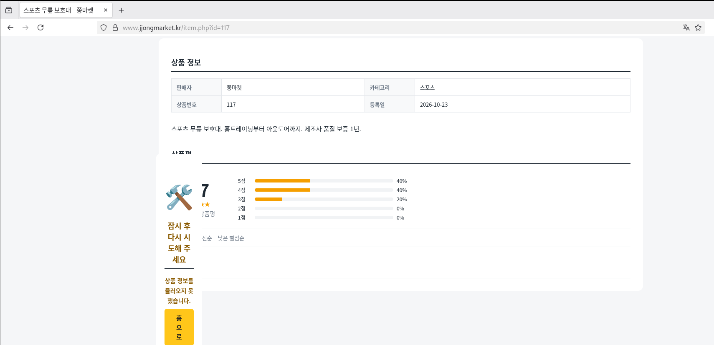
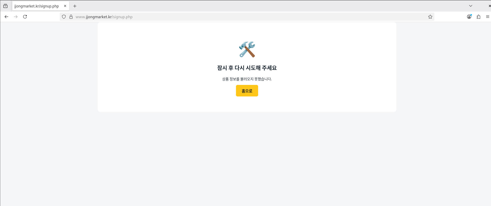
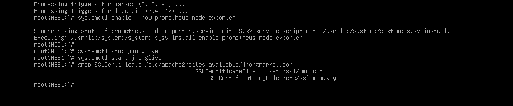

# Troubleshooting

[한국어](../../../docs/troubleshooting.md) | [English](../../en/docs/troubleshooting.md) | [日本語](../../ja/docs/troubleshooting.md) | [简体中文](../../zh-CN/docs/troubleshooting.md) | **Español** | [Français](../../fr/docs/troubleshooting.md)

Problemas en los que realmente me atasqué al construirlo. Están escritos en orden de síntoma, causa y solución, junto con las capturas que hice en su momento.

| # | Síntoma | Capítulo |
| --- | --- | --- |
| 1 | [Todo el coreano de la tienda aparece como cuadrados](#1-todo-el-coreano-de-la-tienda-aparece-como-cuadrados) | WEB |
| 2 | [No se puede pegar coreano en la consola de VMware](#2-no-se-puede-pegar-coreano-en-la-consola-de-vmware) | Todos |
| 3 | [La configuración copiada de Notion contiene `<>`](#3-la-configuración-copiada-de-notion-contiene-) | Keepalived, WEB |
| 4 | [La sangría se desplaza en escalera al pegar en vim](#4-la-sangría-se-desplaza-en-escalera-al-pegar-en-vim) | Todos |
| 5 | [500 Internal Server Error](#5-500-internal-server-error) | WEB |
| 6 | [El detalle del producto se rompe y el registro falla](#6-el-detalle-del-producto-se-rompe-y-el-registro-falla) | WEB |
| 7 | [Todos los campos del pedido están vacíos](#7-todos-los-campos-del-pedido-están-vacíos) | WEB |
| 8 | [Ansible: todo menos MGMT da UNREACHABLE](#8-ansible-todo-menos-mgmt-da-unreachable) | Ansible |
| 9 | [Ansible se detiene en WEB1 (ruta del certificado)](#9-ansible-se-detiene-en-web1-ruta-del-certificado) | Ansible |
| 10 | [Límite de subida de 5 MB de Notion](#10-límite-de-subida-de-5-mb-de-notion) | Gestión de archivos |

---

### 1. Todo el coreano de la tienda aparece como cuadrados


- **Síntoma**: La tienda abre, pero solo el coreano aparece como cuadrados (□). Los números, el inglés y el nombre del servidor `WEB1` se ven bien.
- **Causa**: No era un problema del servidor: en CLIENT (Debian GNOME) **no había fuente coreana**. El HTML llegaba bien en UTF-8, pero no había fuente con la que dibujarlo.
- **Solución**: Instalar fuentes y un método de entrada en CLIENT y REMOTE

  ```bash
  apt install -y fonts-noto-cjk ibus-hangul
  ```

- **Lección**: Primero hay que distinguir si la "rotura" es de codificación o de fuente. Si el inglés y los números están bien y hay exactamente un cuadrado por cada carácter coreano, es un problema de fuente.

### 2. No se puede pegar coreano en la consola de VMware

- **Síntoma**: Al pegar en la consola configuraciones con coreano, como las reglas de alerta de Prometheus o el JSON del panel de Grafana, la parte en coreano desaparece o se corrompe.
- **Causa**: La consola de VMware simula pulsaciones de teclado, así que no admite pegar coreano.
- **Solución**:
  - Los archivos que necesitan coreano (JSON, SQL) se transfieren **como archivo** con `scp` conectando un momento un adaptador NAT
  - En las configuraciones que hay que teclear en la consola (rules-jjong.yml, etc.), pasé los comentarios y textos al inglés

### 3. La configuración copiada de Notion contiene `<>`

- **Síntoma**: keepalived no encuentra el script de comprobación y el `RewriteRule` de Apache se comporta de forma extraña.
- **Causa**: Notion convertía automáticamente en enlaces las URL fuera de los bloques de código, y al copiarlas salían entre corchetes angulares, como `<http://127.0.0.1/health.html>`.
- **Solución**: Borrar los `<` `>` después de pegar. El `^` de `RewriteRule ^ https://...` no se debe borrar.
- **Lección**: Las configuraciones siempre se guardan dentro de bloques de código antes de copiarlas.

### 4. La sangría se desplaza en escalera al pegar en vim

- **Síntoma**: Al pegar YAML o conf, la sangría se acumula en cada línea y los comentarios (`#`) se extienden a la línea siguiente.
- **Causa**: `set si` (smartindent) en vimrc trata lo pegado como si se tecleara y sangra automáticamente.
- **Solución**: `:set paste` antes de pegar y `:set nopaste` al terminar.

### 5. 500 Internal Server Error


- **Síntoma**: Tras subir los archivos de la tienda v2, la página principal da 500.
- **Rastreo**: Funciona al ejecutar como root, pero falla al ejecutar como el usuario de Apache (www-data).

  ```bash
  php index.php | head -5                          # funciona
  runuser -u www-data -- php index.php | head -5   # Permission denied
  ```

  

- **Causa**: La carpeta `inc` enviada desde Windows con `scp -r` tenía permisos `drwx------` (700). www-data no podía abrir `inc/app.php`.

  

- **Solución**:

  ```bash
  chmod -R a+rX /var/www/jjongmarket
  ```

  La `X` mayúscula solo da permiso de ejecución a las carpetas, así que los archivos quedan en 644 y las carpetas en 755.
- **Prevención**: El `web.yml` de Ansible vuelve a poner las carpetas en 755 cada vez. En la prueba de fallos T7 lo cambié a 700 a propósito y comprobé que se restaura.

### 6. El detalle del producto se rompe y el registro falla

| Detalle del producto | Registro |
| --- | --- |
|  |  |

- **Síntoma**: Aparece un cuadro de error en mitad de la página de detalle del producto y el registro dice "Inténtalo de nuevo más tarde".
- **Causa**: `php-mbstring` no estaba instalado. Faltaban `mb_strlen` y `mb_substr`, usados para comprobar la longitud de nombres en coreano y recortar reseñas, así que PHP se detenía a mitad.
- **Solución**:

  ```bash
  apt install -y php-mbstring
  systemctl restart apache2
  ```

  Además añadí en `inc/app.php` funciones alternativas para cuando falta mbstring, de modo que las páginas no caigan aunque falte el paquete.
- **Prevención**: Ansible comprueba que `php-mbstring` esté instalado.

### 7. Todos los campos del pedido están vacíos

- **Síntoma**: En la página del pedido (checkout), el destinatario y la dirección deberían venir rellenados, pero están todos en blanco.
- **Causa**: La cabecera común `header.php` guardaba el mensaje de aviso en la variable `$f`, y la página del pedido también guardaba los valores de entrada en `$f`. Por el orden de los include, se sobrescribía.
- **Solución**: Renombré la variable de `header.php` a `$flash_msg`.
- **Lección**: Los include de PHP comparten el ámbito de variables. En archivos comunes hay que evitar nombres de variable cortos.

### 8. Ansible: todo menos MGMT da UNREACHABLE

- **Síntoma**: En `ansible-playbook site.yml`, solo MGMT da ok y los otros 5 dan UNREACHABLE. Sin embargo, `ssh root@10.10.10.21 hostname` funciona bien.
- **Causa**: Al hacer ssh a mano, una persona escribía la confirmación de la clave de host (yes) y la contraseña, pero Ansible no puede hacer entradas interactivas.
- **Solución**:

  ```bash
  ssh-keyscan 10.10.30.254 10.10.10.10 10.10.10.21 10.10.10.22 10.10.20.10 >> /root/.ssh/known_hosts
  ssh-keygen -t ed25519 -N "" -f /root/.ssh/id_ed25519
  ssh-copy-id root@<cada servidor>
  ```

- **Pendiente**: Esta clave no pasa por la SSH CA. Ver [Verification - Revisión de seguridad](verification.md#revisión-de-seguridad).

### 9. Ansible se detiene en WEB1 (ruta del certificado)


- **Síntoma**: common.yml funciona en los 6 equipos, pero web.yml da failed en `Required files exist` de WEB1.
- **Causa**: El playbook buscaba el certificado en `/etc/ssl/jjong/www.jjongmarket.kr.crt`, pero en realidad estaba en `/etc/ssl/www.crt`.

  

- **Solución**: Cambié las rutas de `web.yml` y `files/jjongmarket.conf` a `/etc/ssl/www.crt` y `/etc/ssl/www.key`.
- **Lección**: Sin esta comprobación, Ansible habría sobrescrito la configuración de Apache con una que apuntaba a una ruta inexistente, y la tienda habría caído en el siguiente reinicio. Gracias a `serial: 1`, se detuvo en WEB1 y no tocó WEB2. Hacer que compruebe las condiciones previas antes de sobrescribir la configuración dio resultado.

### 10. Límite de subida de 5 MB de Notion

- **Síntoma**: No se podían subir el vídeo de JJong LIVE ni el paquete de Grafana a Resources de Notion.
- **Solución**:
  - Recodifiqué el vídeo con `crf 27`, `-preset veryslow`, `-tune animation` y reduje 1 minuto a 3,6 MB
  - Comprimí el deb de Grafana en partes de 4 MB y comprobé con `Get-FileHash` que el archivo unido es igual al original
