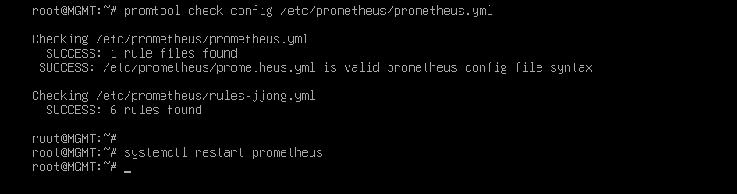

# Verification

[한국어](../../../docs/verification.md) | [English](../../en/docs/verification.md) | [日本語](../../ja/docs/verification.md) | [简体中文](../../zh-CN/docs/verification.md) | **Español** | [Français](../../fr/docs/verification.md)

Aquí se explica cómo funciona realmente cada capítulo si se sigue la Configuration desde el principio, y cómo comprobarlo con tus propios ojos.
Debajo de cada comando está el resultado que debe aparecer si todo va bien. Los comandos de ansible de `[ MGMT ]` se ejecutan en `/etc/ansible`.

- [Comprobaciones por capítulo](#comprobaciones-por-capítulo)
- [Pruebas de fallos](#pruebas-de-fallos)
- [Revisión de seguridad](#revisión-de-seguridad)

## Comprobaciones por capítulo

### Basic Configuration

```bash
# [ MGMT ]
ansible all -a hostname
```
FW, DNS, WEB1, WEB2, DB y MGMT imprimen cada uno su propio nombre desde su equipo.

### IP Configuration

El FW está conectado a las 4 redes, así que todo el tráfico que cruza de una red a otra pasa por el FW.

```bash
# [ FW ]
ip -br a            # ens33 203.0.113.10 / ens37 10.10.10.254 / ens38 10.10.20.254 / ens39 10.10.30.254
# [ DB ]
ip route            # default via 10.10.20.254
# [ MGMT ]
ping -c 2 10.10.20.10     # responde (el FW permite todo desde la red MGMT)
```

### IP Forwarding

```bash
# [ FW ]
sysctl net.ipv4.ip_forward     # = 1
systemctl status rc-local      # active (exited)
```
Debe seguir en 1 tras reiniciar. Se comprueba junto con la prueba de fallos T9.

### DHCP

```bash
# [ CLIENT ]
ip -br a ; ip route        # 10.10.30.1xx, default via 10.10.30.254
# [ REMOTE ]
ip -br a ; ip route        # 203.0.113.1xx, sin default
# [ MGMT ]
journalctl -u isc-dhcp-server | grep DHCPACK
```
En el registro de REMOTE aparece `via 203.0.113.10`. Indica que ha llegado a través del relé del FW.

### Nftables

```bash
# [ REMOTE ] con la VPN apagada
nmap -Pn 203.0.113.10          # solo 53, 80, 443 abiertos
# [ WEB1 ]
nmap -Pn -p 3306 10.10.20.10   # open
nmap -Pn -p 22 10.10.30.10     # filtered
```
Aunque comprometan el servidor web, solo puede llegar al 3306 de la BD y no puede pasar a la red de gestión.
forward no permite icmp, así que los ping entre redes se bloquean salvo los enviados desde MGMT. Por eso se comprueba por puertos.

### Certificate Authority

```bash
# [ MGMT ]
openssl verify -CAfile /etc/ssl/RootCA.crt /etc/ssl/www.crt     # www.crt: OK
# [ CLIENT ]
curl -sI https://www.jjongmarket.kr | head -1                  # HTTP/1.1 200 (sin -k)
```

### DNS

```bash
# [ DNS ]
named-checkconf
# [ CLIENT ]
dig www.jjongmarket.kr +short                    # 10.10.10.100
dig -x 10.10.10.21 +short                        # web1.jjong.internal.
# [ REMOTE ] con la VPN apagada
dig @203.0.113.10 www.jjongmarket.kr +short      # 203.0.113.10
dig @203.0.113.10 ns.jjong.internal              # status: REFUSED
# [ REMOTE ] con la VPN encendida
dig www.jjongmarket.kr +short                    # 10.10.10.100
```
El mismo nombre recibe una respuesta distinta según desde dónde se pregunte. La dirección de origen se mantiene tras el DNAT, así que el DNS puede distinguir las consultas externas.

### Wireguard

```bash
# [ REMOTE ]
nmcli connection up wg0
ip route | grep wg0              # 10.10.0.0/16, 10.8.0.0/24
ssh root@10.10.30.10 hostname    # MGMT
# [ FW ]
wg show                          # latest handshake: hace unos segundos
```
Con la VPN apagada, el mismo ssh falla con `Network is unreachable`. Es porque REMOTE no recibe puerta de enlace por DHCP.

### SSH

```bash
# [ MGMT ]
ssh-keygen -L -f /root/.ssh/id_ecdsa-cert.pub        # Key ID "jjong root key", Principals: root
ssh -i /root/.ssh/id_ecdsa root@10.10.20.10 hostname # a DB sin contraseña
```

### Chrony

```bash
# [ MGMT ]
ansible 'all:!dns' -a "chronyc sources"     # todos ^* 10.10.10.10
# [ DNS ]
chronyc clients
```

### MariaDB

```bash
# [ DB ]
ss -lntp | grep 3306                                                           # 10.10.20.10:3306
mariadb -e "select count(*) from shop.products; select count(*) from shop.reviews"   # 160, 800
mariadb -e "show grants for 'shop'@'10.10.10.%'"
# [ WEB1 ]
ls -l /etc/jjongmarket/db.ini                                                  # -rw-r----- root www-data
```

### Backup

```bash
# [ DB ]
/usr/local/sbin/mariadb-backup.sh
ls -l /var/backups/mariadb                 # shop_fecha_hora.sql.gz, -rw-------
journalctl -t mariadb-backup -n 3          # OK
# [ MGMT ]
rsync -a --exclude '*.tmp' 10.10.20.10:/var/backups/mariadb/ /srv/backup/db/ && ls -l /srv/backup/db
```

### Keepalived

```bash
# [ WEB1, WEB2 ]
ip -br a show ens33                                   # 10.10.10.100 solo en WEB1
journalctl -u keepalived | grep STATE | tail -2       # MASTER / BACKUP
# [ CLIENT ]
curl -s http://www.jjongmarket.kr/health.html         # WEB1
```

### WEB

```bash
# [ CLIENT ]
curl -sI http://www.jjongmarket.kr | grep -i location                                   # https://www.jjongmarket.kr/
curl -s -o /dev/null -w '%{http_code}\n' https://www.jjongmarket.kr/inc/app.php         # 403
echo | openssl s_client -connect www.jjongmarket.kr:443 2>/dev/null | openssl x509 -noout -ext subjectAltName
# [ REMOTE ] como cliente externo
curl -sI --resolve www.jjongmarket.kr:443:203.0.113.10 https://www.jjongmarket.kr | head -1   # 200
```
Inicia sesión en Firefox con `demo@jjongmarket.kr` y haz un pedido. El pedido aparece en Mi JJong y la fase de envío cambia con el tiempo.

### Streaming

```bash
# [ WEB1 ]
systemctl is-active jjonglive
grep MEDIA-SEQUENCE /var/www/hls/stream.m3u8    # si vuelves a mirar unos segundos después, el número ha subido
# [ CLIENT ]
curl -s https://www.jjongmarket.kr/hls/stream.m3u8 | head -1    # #EXTM3U
```


### Monitoring

```bash
# [ MGMT ]
promtool check rules /etc/prometheus/rules-jjong.yml
curl -s localhost:9090/api/v1/targets | grep -o '"health":"[a-z]*"' | sort | uniq -c    # 10 "health":"up"
```



CLIENT Firefox: `http://10.10.30.10:9090/targets` todo UP, `/alerts` todo Inactive, `http://10.10.30.10:3000` Estado de la infraestructura de JJongMarket.

### Ansible

```bash
# [ MGMT ]
ansible all -m ping
ansible-playbook site.yml      # a partir de la segunda ejecución, changed=0 en todos los equipos
```

## Pruebas de fallos

Con el panel de Grafana abierto en CLIENT, se hacen una por una.

| # | Situación | Dónde | Método | Resultado esperado | Recuperación |
| --- | --- | --- | --- | --- | --- |
| T1 | Parada del servicio web | WEB1 | `systemctl stop apache2` | En segundos la VIP pasa a WEB2. health.html muestra WEB2, se mantiene la sesión | `systemctl start apache2` |
| T2 | Apagado del servidor web | WEB1 | `poweroff` | WEB2 toma la VIP, HostDown tras 1 minuto | Encender en VMware |
| T3 | Parada de la emisión | WEB con la VIP | `systemctl stop jjonglive` | JJong LIVE muestra "Preparando la emisión", LiveDown | `systemctl start jjonglive` |
| T4 | Parada de la BD | DB | `systemctl stop mariadb` | Página de error de la tienda, MariaDBDown·ShopDown | `systemctl start mariadb` |
| T5 | Borrado y restauración de la BD | DB | T5 abajo | 160 productos recuperados | - |
| T6 | Reinicio de la VPN | FW | `systemctl restart wg-quick@wg0` | El SSH de REMOTE se detiene un momento y continúa | - |
| T7 | Configuración alterada | WEB2 → MGMT | `chmod 700 .../inc` → `ansible-playbook web.yml --limit web2` | El playbook la restaura | - |
| T8 | Disco lleno | MGMT | `fallocate -l 15G /tmp/fill` | DiskAlmostFull | `rm /tmp/fill` |
| T9 | Reinicio completo | MGMT | T9 abajo | Todos los servicios vuelven a levantarse solos | - |

En T1 la sesión se mantiene porque las sesiones se guardan en la BD, no en el servidor web.

**T5. Restaurar desde copia de seguridad** - [ DB ]

```bash
/usr/local/sbin/mariadb-backup.sh                       # primero, la copia más reciente
B=$(ls -t /var/backups/mariadb/*.sql.gz | head -1)
mariadb -e "drop database shop"                         # la tienda da error
gunzip -c $B | mariadb
mariadb -e "select count(*) from shop.products"         # 160
```
El volcado se hace con `--databases shop`, así que el archivo incluye CREATE DATABASE. Los permisos de las cuentas están aparte en la BD mysql, así que se conservan.

**T9. Reinicio completo** - [ MGMT ]

```bash
ansible 'all:!mgmt' -m reboot
ansible fw -a "sysctl net.ipv4.ip_forward"     # = 1 (rc.local)
ansible-playbook site.yml                      # changed=0
```

## Revisión de seguridad

Puntos débiles que encontré durante la revisión.

**1. La clave privada de la SSH CA está en todos los servidores**
En el capítulo SSH, al copiar todo `/etc/ssl`, `ssh-CA/ca` (la clave privada de la CA) y `www.key` acabaron también en FW, DNS y DB. Los servidores solo necesitan `ca.pub`.

```bash
# [ MGMT ]
ansible 'all:!mgmt' -m file -a "path=/etc/ssl/ssh-CA/ca state=absent"
ansible 'fw:dns:db' -m file -a "path=/etc/ssl/www.key state=absent"
ansible all -m ping
```

**2. Se añadió una clave que no pasa por la CA**
En el capítulo Ansible se añadió una clave ed25519 con `ssh-copy-id`. Esta clave permite conectarse sin firma de la CA ni periodo de validez. La siguiente tarea es poner `private_key_file = /root/.ssh/id_ecdsa` en `ansible.cfg` y vaciar authorized_keys.

**3. REMOTE con la VPN apagada no resuelve nombres**
El DHCP también da a REMOTE el DNS 10.10.10.10, pero con la VPN apagada no hay ruta hasta esa dirección. Si se cambia el DNS del rango 203.0.113.0 a 203.0.113.10, responderá la view externa.

**4. Grafana por http y con la cuenta por defecto**
Está abierto en el puerto 3000 por http. Se está estudiando añadir https con el certificado de la CA privada.
