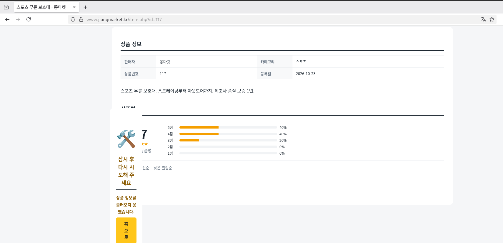
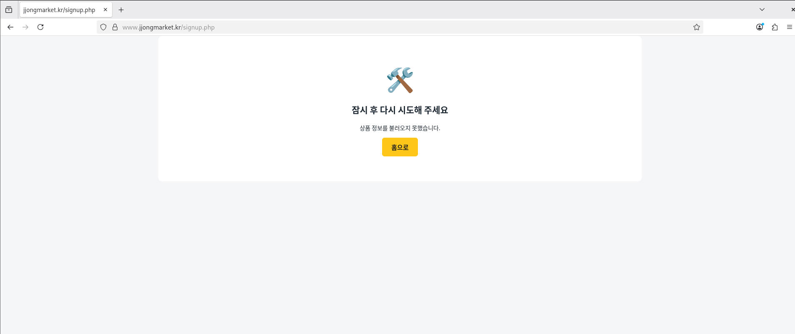
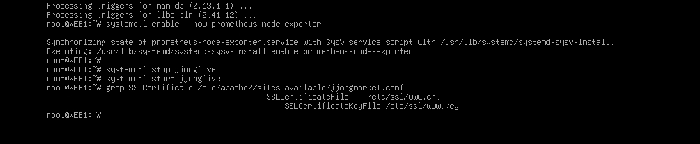

# Troubleshooting

[한국어](../../../docs/troubleshooting.md) | [English](../../en/docs/troubleshooting.md) | [日本語](../../ja/docs/troubleshooting.md) | [简体中文](../../zh-CN/docs/troubleshooting.md) | [Español](../../es/docs/troubleshooting.md) | **Français**

Les problèmes sur lesquels j'ai réellement bloqué pendant la construction, décrits dans l'ordre symptôme, cause, solution, avec les captures d'écran prises sur le moment.

| # | Symptôme | Chapitre |
| --- | --- | --- |
| 1 | [Tout le coréen de la boutique s'affiche en carrés](#1-tout-le-coréen-de-la-boutique-saffiche-en-carrés) | WEB |
| 2 | [Impossible de coller du coréen dans la console VMware](#2-impossible-de-coller-du-coréen-dans-la-console-vmware) | Tous |
| 3 | [La configuration copiée depuis Notion contient des `<>`](#3-la-configuration-copiée-depuis-notion-contient-des-) | Keepalived, WEB |
| 4 | [L'indentation se décale en escalier en collant dans vim](#4-lindentation-se-décale-en-escalier-en-collant-dans-vim) | Tous |
| 5 | [500 Internal Server Error](#5-500-internal-server-error) | WEB |
| 6 | [La page produit est cassée et l'inscription échoue](#6-la-page-produit-est-cassée-et-linscription-échoue) | WEB |
| 7 | [Tous les champs de la commande sont vides](#7-tous-les-champs-de-la-commande-sont-vides) | WEB |
| 8 | [Ansible : tout sauf MGMT est UNREACHABLE](#8-ansible--tout-sauf-mgmt-est-unreachable) | Ansible |
| 9 | [Ansible s'arrête sur WEB1 (chemin du certificat)](#9-ansible-sarrête-sur-web1-chemin-du-certificat) | Ansible |
| 10 | [Limite d'envoi de 5 Mo de Notion](#10-limite-denvoi-de-5-mo-de-notion) | Gestion des fichiers |

---

### 1. Tout le coréen de la boutique s'affiche en carrés


- **Symptôme** : La boutique s'ouvre, mais seul le coréen s'affiche en carrés (□). Les chiffres, l'anglais et le nom du serveur `WEB1` sont corrects.
- **Cause** : Ce n'était pas un problème de serveur : CLIENT (Debian GNOME) **n'avait pas de police coréenne**. Le HTML arrivait bien en UTF-8, mais aucune police ne permettait de l'afficher.
- **Solution** : Installer des polices et une méthode de saisie sur CLIENT et REMOTE

  ```bash
  apt install -y fonts-noto-cjk ibus-hangul
  ```

- **Leçon** : Il faut d'abord distinguer si la « casse » vient de l'encodage ou de la police. Si l'anglais et les chiffres sont corrects et qu'il y a exactement un carré par caractère coréen, c'est un problème de police.

### 2. Impossible de coller du coréen dans la console VMware

- **Symptôme** : En collant dans la console des configurations contenant du coréen, comme les règles d'alerte Prometheus ou le JSON du tableau de bord Grafana, la partie en coréen disparaît ou se corrompt.
- **Cause** : La console VMware simule des frappes clavier, elle ne prend donc pas en charge le collage de coréen.
- **Solution** :
  - Les fichiers qui ont vraiment besoin du coréen (JSON, SQL) sont transférés **en tant que fichiers** avec `scp` en branchant brièvement un adaptateur NAT
  - Pour les configurations à taper dans la console (rules-jjong.yml, etc.), les commentaires et textes ont été passés en anglais

### 3. La configuration copiée depuis Notion contient des `<>`

- **Symptôme** : keepalived ne trouve pas le script de contrôle de santé et le `RewriteRule` d'Apache se comporte bizarrement.
- **Cause** : Notion transformait automatiquement en liens les URL situées hors des blocs de code ; une fois copiées, elles apparaissaient entre chevrons, comme `<http://127.0.0.1/health.html>`.
- **Solution** : Supprimer les `<` `>` après le collage. Ne pas supprimer le `^` de `RewriteRule ^ https://...`.
- **Leçon** : Toujours placer les configurations dans des blocs de code avant de les copier.

### 4. L'indentation se décale en escalier en collant dans vim

- **Symptôme** : En collant du YAML ou du conf, l'indentation s'accumule à chaque ligne et les commentaires (`#`) débordent sur la ligne suivante.
- **Cause** : `set si` (smartindent) dans vimrc traite le texte collé comme une saisie et l'indente automatiquement.
- **Solution** : `:set paste` avant de coller, `:set nopaste` après.

### 5. 500 Internal Server Error


- **Symptôme** : Après l'envoi des fichiers de la boutique v2, la page d'accueil renvoie 500.
- **Analyse** : Fonctionne en root, échoue avec l'utilisateur d'Apache (www-data).

  ```bash
  php index.php | head -5                          # fonctionne
  runuser -u www-data -- php index.php | head -5   # Permission denied
  ```

  

- **Cause** : Le dossier `inc` envoyé depuis Windows avec `scp -r` avait les permissions `drwx------` (700). www-data ne pouvait pas ouvrir `inc/app.php`.

  

- **Solution** :

  ```bash
  chmod -R a+rX /var/www/jjongmarket
  ```

  Le `X` majuscule ne donne le droit d'exécution qu'aux dossiers : les fichiers passent en 644 et les dossiers en 755.
- **Prévention** : Le `web.yml` d'Ansible remet les dossiers en 755 à chaque fois. Au test de panne T7, je les ai volontairement passés en 700 et j'ai vérifié qu'ils étaient rétablis.

### 6. La page produit est cassée et l'inscription échoue

| Page produit | Inscription |
| --- | --- |
|  |  |

- **Symptôme** : Une boîte d'erreur apparaît au milieu de la page produit, et l'inscription affiche « Veuillez réessayer plus tard ».
- **Cause** : `php-mbstring` n'était pas installé. `mb_strlen` et `mb_substr`, utilisés pour vérifier la longueur des noms en coréen ou tronquer les avis, manquaient, et PHP s'arrêtait en cours de route.
- **Solution** :

  ```bash
  apt install -y php-mbstring
  systemctl restart apache2
  ```

  J'ai aussi ajouté dans `inc/app.php` des fonctions de repli pour quand mbstring est absent, afin que les pages ne plantent pas même sans le paquet.
- **Prévention** : Ansible vérifie que `php-mbstring` est installé.

### 7. Tous les champs de la commande sont vides

- **Symptôme** : Sur la page de commande (checkout), le destinataire et l'adresse devraient être pré-remplis, mais tout est vide.
- **Cause** : L'en-tête commun `header.php` stockait le message d'information dans la variable `$f`, et la page de commande stockait aussi ses valeurs dans `$f`. À cause de l'ordre des include, elle était écrasée.
- **Solution** : Renommer la variable de `header.php` en `$flash_msg`.
- **Leçon** : Les include PHP partagent la portée des variables. Dans les fichiers communs, il faut éviter les noms de variables courts.

### 8. Ansible : tout sauf MGMT est UNREACHABLE

- **Symptôme** : Avec `ansible-playbook site.yml`, seul MGMT est ok et les 5 autres sont UNREACHABLE. Pourtant `ssh root@10.10.10.21 hostname` fonctionne.
- **Cause** : En ssh manuel, une personne tapait la confirmation de la clé d'hôte (yes) et le mot de passe, mais Ansible ne peut pas faire de saisie interactive.
- **Solution** :

  ```bash
  ssh-keyscan 10.10.30.254 10.10.10.10 10.10.10.21 10.10.10.22 10.10.20.10 >> /root/.ssh/known_hosts
  ssh-keygen -t ed25519 -N "" -f /root/.ssh/id_ed25519
  ssh-copy-id root@<chaque serveur>
  ```

- **Reste à faire** : Cette clé ne passe pas par la SSH CA. Voir [Verification - Revue de sécurité](verification.md#revue-de-sécurité).

### 9. Ansible s'arrête sur WEB1 (chemin du certificat)


- **Symptôme** : common.yml réussit sur les 6 machines, mais web.yml échoue (failed) à `Required files exist` sur WEB1.
- **Cause** : Le playbook cherchait le certificat dans `/etc/ssl/jjong/www.jjongmarket.kr.crt`, alors qu'il se trouvait en réalité dans `/etc/ssl/www.crt`.

  

- **Solution** : Correction des chemins dans `web.yml` et `files/jjongmarket.conf` en `/etc/ssl/www.crt` et `/etc/ssl/www.key`.
- **Leçon** : Sans cette vérification, Ansible aurait écrasé la configuration d'Apache avec une configuration pointant vers un chemin inexistant, et la boutique serait tombée au prochain redémarrage. Grâce à `serial: 1`, il s'est arrêté sur WEB1 sans toucher à WEB2. Lui faire vérifier les prérequis avant d'écraser la configuration a porté ses fruits.

### 10. Limite d'envoi de 5 Mo de Notion

- **Symptôme** : Impossible d'envoyer la vidéo JJong LIVE et le paquet Grafana dans Resources sur Notion.
- **Solution** :
  - Vidéo réencodée avec `crf 27`, `-preset veryslow`, `-tune animation` pour réduire 1 minute à 3,6 Mo
  - Deb de Grafana découpé en parties de 4 Mo, puis vérification avec `Get-FileHash` que le fichier reconstitué est identique à l'original
