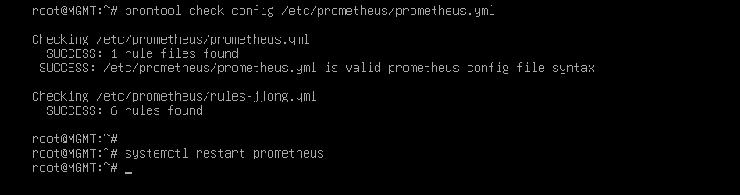

# Verification

[한국어](../../../docs/verification.md) | [English](../../en/docs/verification.md) | [日本語](../../ja/docs/verification.md) | [简体中文](../../zh-CN/docs/verification.md) | [Español](../../es/docs/verification.md) | **Français**

Ce document explique comment chaque chapitre fonctionne réellement quand on suit la Configuration depuis le début, et comment le constater de ses propres yeux.
Sous chaque commande figure le résultat attendu quand tout est normal. Les commandes ansible de `[ MGMT ]` s'exécutent dans `/etc/ansible`.

- [Vérifications par chapitre](#vérifications-par-chapitre)
- [Tests de panne](#tests-de-panne)
- [Revue de sécurité](#revue-de-sécurité)

## Vérifications par chapitre

### Basic Configuration

```bash
# [ MGMT ]
ansible all -a hostname
```
FW, DNS, WEB1, WEB2, DB et MGMT affichent chacun leur propre nom depuis leur machine.

### IP Configuration

Le FW est relié aux 4 réseaux : tout le trafic qui passe d'un réseau à l'autre traverse le FW.

```bash
# [ FW ]
ip -br a            # ens33 203.0.113.10 / ens37 10.10.10.254 / ens38 10.10.20.254 / ens39 10.10.30.254
# [ DB ]
ip route            # default via 10.10.20.254
# [ MGMT ]
ping -c 2 10.10.20.10     # répond (le FW autorise tout depuis le réseau MGMT)
```

### IP Forwarding

```bash
# [ FW ]
sysctl net.ipv4.ip_forward     # = 1
systemctl status rc-local      # active (exited)
```
La valeur doit rester à 1 après un redémarrage. Vérifié en même temps que le test de panne T9.

### DHCP

```bash
# [ CLIENT ]
ip -br a ; ip route        # 10.10.30.1xx, default via 10.10.30.254
# [ REMOTE ]
ip -br a ; ip route        # 203.0.113.1xx, pas de default
# [ MGMT ]
journalctl -u isc-dhcp-server | grep DHCPACK
```
Le journal de REMOTE indique `via 203.0.113.10`, signe que la requête est passée par le relais du FW.

### Nftables

```bash
# [ REMOTE ] VPN désactivé
nmap -Pn 203.0.113.10          # seuls 53, 80, 443 sont open
# [ WEB1 ]
nmap -Pn -p 3306 10.10.20.10   # open
nmap -Pn -p 22 10.10.30.10     # filtered
```
Même si le serveur web est compromis, il ne peut atteindre que le port 3306 de la base et ne peut pas passer sur le réseau de gestion.
forward n'autorise pas l'icmp : les ping entre réseaux sont bloqués, sauf ceux envoyés depuis MGMT. C'est pourquoi les vérifications se font par port.

### Certificate Authority

```bash
# [ MGMT ]
openssl verify -CAfile /etc/ssl/RootCA.crt /etc/ssl/www.crt     # www.crt: OK
# [ CLIENT ]
curl -sI https://www.jjongmarket.kr | head -1                  # HTTP/1.1 200 (sans -k)
```

### DNS

```bash
# [ DNS ]
named-checkconf
# [ CLIENT ]
dig www.jjongmarket.kr +short                    # 10.10.10.100
dig -x 10.10.10.21 +short                        # web1.jjong.internal.
# [ REMOTE ] VPN désactivé
dig @203.0.113.10 www.jjongmarket.kr +short      # 203.0.113.10
dig @203.0.113.10 ns.jjong.internal              # status: REFUSED
# [ REMOTE ] VPN activé
dig www.jjongmarket.kr +short                    # 10.10.10.100
```
Le même nom reçoit une réponse différente selon l'endroit d'où l'on interroge. L'adresse source reste inchangée après le DNAT, ce qui permet au DNS de distinguer les requêtes externes.

### Wireguard

```bash
# [ REMOTE ]
nmcli connection up wg0
ip route | grep wg0              # 10.10.0.0/16, 10.8.0.0/24
ssh root@10.10.30.10 hostname    # MGMT
# [ FW ]
wg show                          # latest handshake: il y a quelques secondes
```
VPN désactivé, le même ssh échoue avec `Network is unreachable`, car REMOTE ne reçoit pas de passerelle du DHCP.

### SSH

```bash
# [ MGMT ]
ssh-keygen -L -f /root/.ssh/id_ecdsa-cert.pub        # Key ID "jjong root key", Principals: root
ssh -i /root/.ssh/id_ecdsa root@10.10.20.10 hostname # vers DB sans mot de passe
```

### Chrony

```bash
# [ MGMT ]
ansible 'all:!dns' -a "chronyc sources"     # tous ^* 10.10.10.10
# [ DNS ]
chronyc clients
```

### MariaDB

```bash
# [ DB ]
ss -lntp | grep 3306                                                           # 10.10.20.10:3306
mariadb -e "select count(*) from shop.products; select count(*) from shop.reviews"   # 160, 800
mariadb -e "show grants for 'shop'@'10.10.10.%'"
# [ WEB1 ]
ls -l /etc/jjongmarket/db.ini                                                  # -rw-r----- root www-data
```

### Backup

```bash
# [ DB ]
/usr/local/sbin/mariadb-backup.sh
ls -l /var/backups/mariadb                 # shop_date_heure.sql.gz, -rw-------
journalctl -t mariadb-backup -n 3          # OK
# [ MGMT ]
rsync -a --exclude '*.tmp' 10.10.20.10:/var/backups/mariadb/ /srv/backup/db/ && ls -l /srv/backup/db
```

### Keepalived

```bash
# [ WEB1, WEB2 ]
ip -br a show ens33                                   # 10.10.10.100 uniquement sur WEB1
journalctl -u keepalived | grep STATE | tail -2       # MASTER / BACKUP
# [ CLIENT ]
curl -s http://www.jjongmarket.kr/health.html         # WEB1
```

### WEB

```bash
# [ CLIENT ]
curl -sI http://www.jjongmarket.kr | grep -i location                                   # https://www.jjongmarket.kr/
curl -s -o /dev/null -w '%{http_code}\n' https://www.jjongmarket.kr/inc/app.php         # 403
echo | openssl s_client -connect www.jjongmarket.kr:443 2>/dev/null | openssl x509 -noout -ext subjectAltName
# [ REMOTE ] en tant que client externe
curl -sI --resolve www.jjongmarket.kr:443:203.0.113.10 https://www.jjongmarket.kr | head -1   # 200
```
Connectez-vous dans Firefox avec `demo@jjongmarket.kr` et passez une commande. Elle apparaît dans Mon JJong, et l'étape de livraison évolue avec le temps.

### Streaming

```bash
# [ WEB1 ]
systemctl is-active jjonglive
grep MEDIA-SEQUENCE /var/www/hls/stream.m3u8    # quelques secondes plus tard, le nombre a augmenté
# [ CLIENT ]
curl -s https://www.jjongmarket.kr/hls/stream.m3u8 | head -1    # #EXTM3U
```


### Monitoring

```bash
# [ MGMT ]
promtool check rules /etc/prometheus/rules-jjong.yml
curl -s localhost:9090/api/v1/targets | grep -o '"health":"[a-z]*"' | sort | uniq -c    # 10 "health":"up"
```



CLIENT Firefox : `http://10.10.30.10:9090/targets` tout en UP, `/alerts` tout en Inactive, `http://10.10.30.10:3000` État de l'infrastructure JJongMarket.

### Ansible

```bash
# [ MGMT ]
ansible all -m ping
ansible-playbook site.yml      # à partir de la deuxième exécution, changed=0 sur toutes les machines
```

## Tests de panne

Gardez le tableau de bord Grafana ouvert sur CLIENT et procédez un par un.

| # | Situation | Où | Méthode | Résultat attendu | Rétablissement |
| --- | --- | --- | --- | --- | --- |
| T1 | Arrêt du service web | WEB1 | `systemctl stop apache2` | La VIP passe sur WEB2 en quelques secondes. health.html affiche WEB2, la session est conservée | `systemctl start apache2` |
| T2 | Serveur web éteint | WEB1 | `poweroff` | WEB2 reprend la VIP, HostDown après 1 minute | Rallumer dans VMware |
| T3 | Arrêt de la diffusion | WEB qui détient la VIP | `systemctl stop jjonglive` | JJong LIVE affiche « Diffusion en préparation », LiveDown | `systemctl start jjonglive` |
| T4 | Arrêt de la base | DB | `systemctl stop mariadb` | Page d'erreur de la boutique, MariaDBDown·ShopDown | `systemctl start mariadb` |
| T5 | Suppression puis restauration de la base | DB | T5 ci-dessous | 160 produits restaurés | - |
| T6 | Redémarrage du VPN | FW | `systemctl restart wg-quick@wg0` | Le SSH de REMOTE se fige un instant puis reprend | - |
| T7 | Dérive de configuration | WEB2 → MGMT | `chmod 700 .../inc` → `ansible-playbook web.yml --limit web2` | Le playbook la rétablit | - |
| T8 | Disque plein | MGMT | `fallocate -l 15G /tmp/fill` | DiskAlmostFull | `rm /tmp/fill` |
| T9 | Redémarrage complet | MGMT | T9 ci-dessous | Tous les services redémarrent d'eux-mêmes | - |

En T1, la session est conservée car les sessions sont stockées dans la base et non sur le serveur web.

**T5. Restauration depuis la sauvegarde** - [ DB ]

```bash
/usr/local/sbin/mariadb-backup.sh                       # d'abord la sauvegarde la plus récente
B=$(ls -t /var/backups/mariadb/*.sql.gz | head -1)
mariadb -e "drop database shop"                         # la boutique est en erreur
gunzip -c $B | mariadb
mariadb -e "select count(*) from shop.products"         # 160
```
Le dump est fait avec `--databases shop`, le fichier contient donc le CREATE DATABASE. Les droits des comptes sont stockés à part dans la base mysql et restent intacts.

**T9. Redémarrage complet** - [ MGMT ]

```bash
ansible 'all:!mgmt' -m reboot
ansible fw -a "sysctl net.ipv4.ip_forward"     # = 1 (rc.local)
ansible-playbook site.yml                      # changed=0
```

## Revue de sécurité

Les points faibles relevés pendant la revue.

**1. La clé privée de la SSH CA est sur tous les serveurs**
Au chapitre SSH, la copie de tout `/etc/ssl` a aussi placé `ssh-CA/ca` (la clé privée de la CA) et `www.key` sur FW, DNS et DB. Les serveurs n'ont besoin que de `ca.pub`.

```bash
# [ MGMT ]
ansible 'all:!mgmt' -m file -a "path=/etc/ssl/ssh-CA/ca state=absent"
ansible 'fw:dns:db' -m file -a "path=/etc/ssl/www.key state=absent"
ansible all -m ping
```

**2. Une clé qui contourne la CA a été ajoutée**
Au chapitre Ansible, une clé ed25519 a été ajoutée avec `ssh-copy-id`. Elle permet de se connecter sans signature de la CA ni durée de validité. La prochaine étape est de définir `private_key_file = /root/.ssh/id_ecdsa` dans `ansible.cfg` et de vider authorized_keys.

**3. REMOTE sans VPN ne peut pas résoudre les noms**
Le DHCP fournit aussi à REMOTE le DNS 10.10.10.10, mais VPN désactivé, il n'existe aucune route vers cette adresse. En remplaçant le DNS de la plage 203.0.113.0 par 203.0.113.10, c'est la view externe qui répondrait.

**4. Grafana en http, avec le compte par défaut**
Il est ouvert sur le port 3000 en http. L'ajout du https avec le certificat de la CA privée est à l'étude.
