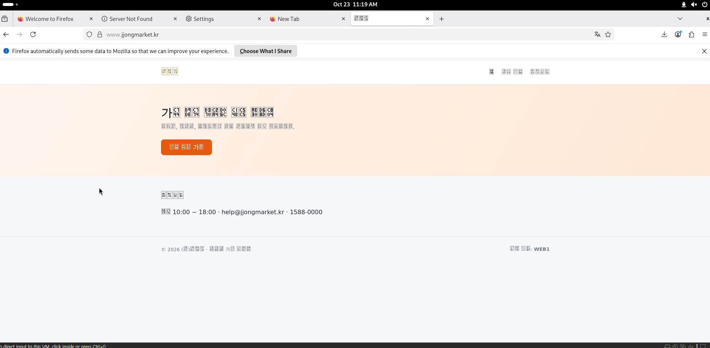
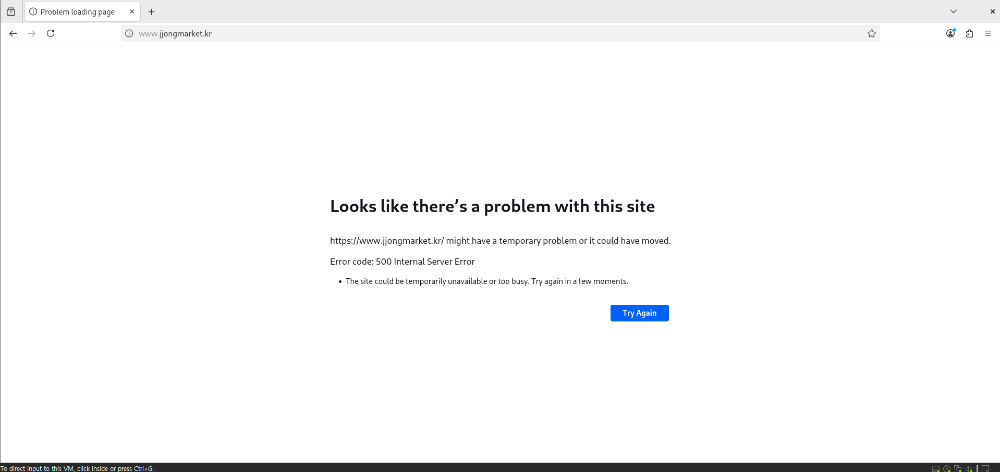
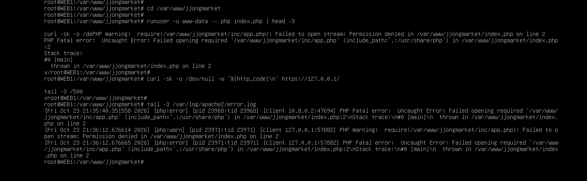
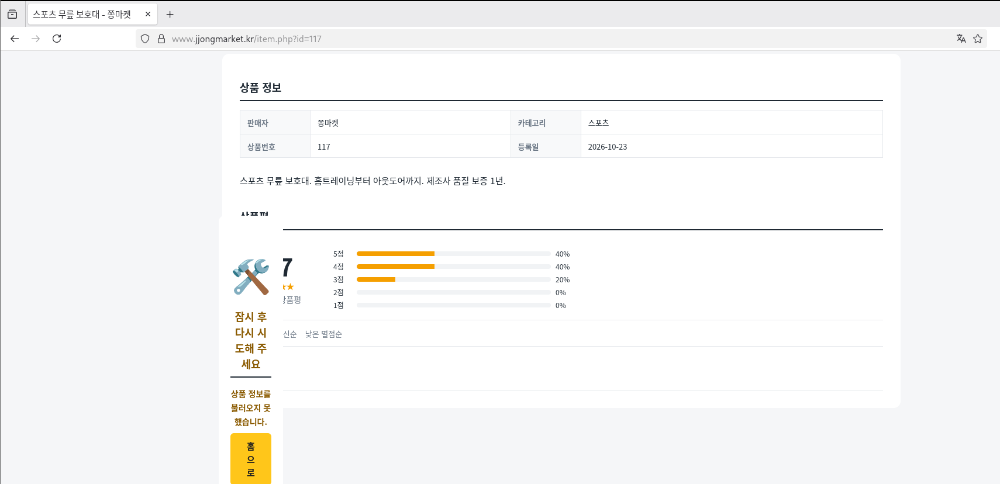
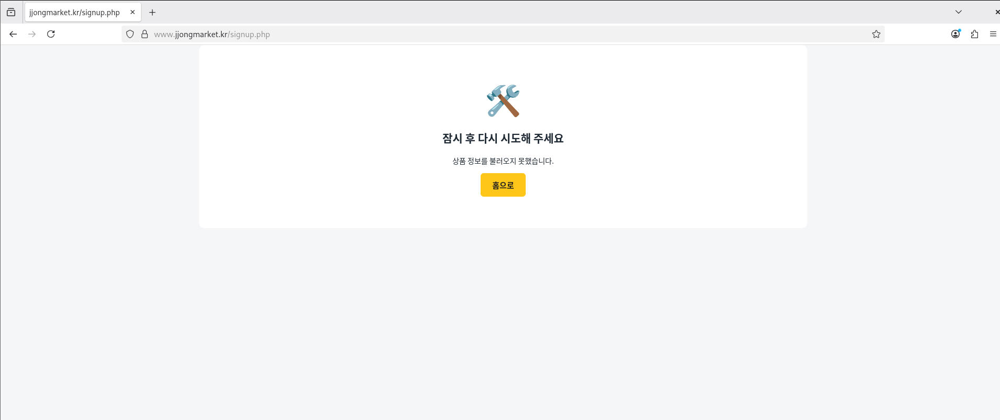
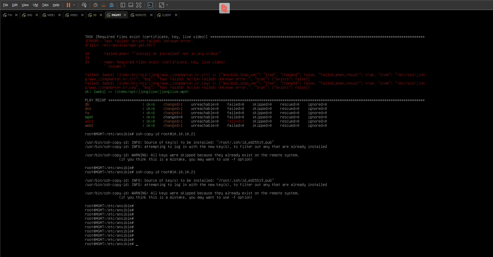
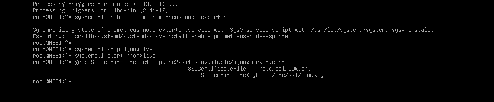

# Troubleshooting

[한국어](../../../docs/troubleshooting.md) | [English](../../en/docs/troubleshooting.md) | **日本語** | [简体中文](../../zh-CN/docs/troubleshooting.md) | [Español](../../es/docs/troubleshooting.md) | [Français](../../fr/docs/troubleshooting.md)

自分で構築しながら実際に詰まった問題です。症状、原因、解決の順に書き、そのときに撮った画面も一緒に載せました。

| # | 症状 | 章 |
| --- | --- | --- |
| 1 | [ショップのハングルがすべて四角で表示される](#1-ショップのハングルがすべて四角で表示される) | WEB |
| 2 | [VMware コンソールにハングルを貼り付けられない](#2-vmware-コンソールにハングルを貼り付けられない) | 全体 |
| 3 | [Notion からコピーした設定に `<>` が混ざっている](#3-notion-からコピーした設定に--が混ざっている) | Keepalived, WEB |
| 4 | [vim に貼り付けるとインデントが階段状にずれる](#4-vim-に貼り付けるとインデントが階段状にずれる) | 全体 |
| 5 | [500 Internal Server Error](#5-500-internal-server-error) | WEB |
| 6 | [商品詳細が崩れ、会員登録ができない](#6-商品詳細が崩れ会員登録ができない) | WEB |
| 7 | [注文フォームの入力欄がすべて空](#7-注文フォームの入力欄がすべて空) | WEB |
| 8 | [Ansible で MGMT 以外すべて UNREACHABLE](#8-ansible-で-mgmt-以外すべて-unreachable) | Ansible |
| 9 | [Ansible が WEB1 で停止 (証明書のパス)](#9-ansible-が-web1-で停止-証明書のパス) | Ansible |
| 10 | [Notion の 5MB アップロード制限](#10-notion-の-5mb-アップロード制限) | 資料管理 |

---

### 1. ショップのハングルがすべて四角で表示される



- **症状**: ショップは開くが、ハングルだけがすべて四角(□)で表示される。数字、英語、サーバー名 `WEB1` は正常。
- **原因**: サーバーの問題ではなく、CLIENT(Debian GNOME)に**ハングルフォントがない**。HTML は UTF-8 で正しく届いていたが、描画するフォントがなかった。
- **解決**: CLIENT、REMOTE にフォントと入力メソッドをインストール

  ```bash
  apt install -y fonts-noto-cjk ibus-hangul
  ```

- **学んだこと**: 「文字化け」がエンコーディングの問題かフォントの問題かを先に見分ける必要がある。英語と数字は問題なく、ハングルの位置に四角がちょうど1文字ずつあるならフォントの問題だ。

### 2. VMware コンソールにハングルを貼り付けられない

- **症状**: Prometheus のアラートルールや Grafana ダッシュボードの JSON のように、ハングルを含む設定をコンソールに貼り付けると、ハングル部分が消えたり崩れたりする。
- **原因**: VMware コンソールはキー入力を模倣する方式なので、ハングルの貼り付けに対応していない。
- **解決**:
  - ハングルが必要なファイル(JSON、SQL)は NAT アダプターを一時的に付けて `scp` で**ファイルごと**転送
  - コンソールで入力する必要がある設定(rules-jjong.yml など)は、コメントと文言を英語に変更

### 3. Notion からコピーした設定に `<>` が混ざっている

- **症状**: keepalived がヘルスチェックのスクリプトを見つけられず、Apache の `RewriteRule` がおかしな動作をする。
- **原因**: Notion がコードブロック外の URL を自動でリンクに変換し、コピーすると `<http://127.0.0.1/health.html>` のように山かっこが付いて出てきた。
- **解決**: 貼り付けたあとに `<` `>` を削除。`RewriteRule ^ https://...` の `^` は消してはいけない。
- **学んだこと**: 設定は必ずコードブロックの中に入れておいてからコピーする。

### 4. vim に貼り付けるとインデントが階段状にずれる

- **症状**: YAML や conf を貼り付けると、行ごとにインデントが積み重なり、コメント(`#`)が次の行に広がる。
- **原因**: vimrc の `set si`(smartindent)が貼り付けた文字をタイピングとみなして自動インデントする。
- **解決**: 貼り付ける前に `:set paste`、終わったら `:set nopaste`。

### 5. 500 Internal Server Error



- **症状**: ショップ v2 のファイルをアップロードしたあと、メインページが 500。
- **追跡**: root で実行すると正常なのに、Apache ユーザー(www-data)で実行すると失敗。

  ```bash
  php index.php | head -5                          # 正常
  runuser -u www-data -- php index.php | head -5   # Permission denied
  ```

  

- **原因**: Windows から `scp -r` で送った `inc` フォルダーの権限が `drwx------`(700)だった。www-data が `inc/app.php` を開けなかった。

  

- **解決**:

  ```bash
  chmod -R a+rX /var/www/jjongmarket
  ```

  `X`(大文字)はフォルダーにだけ実行権限を与えるので、ファイルは 644、フォルダーは 755 になる。
- **再発防止**: Ansible の `web.yml` が毎回フォルダーを 755 に揃える。障害テスト T7 でわざと 700 に変え、元に戻ることを確認した。

### 6. 商品詳細が崩れ、会員登録ができない

| 商品詳細 | 会員登録 |
| --- | --- |
|  |  |

- **症状**: 商品詳細ページの途中にエラーボックスが割り込み、会員登録は「しばらくしてからもう一度お試しください」。
- **原因**: `php-mbstring` がインストールされていない。ハングルの名前の長さチェックやレビューの切り詰めに使う `mb_strlen`、`mb_substr` がなく、PHP が途中で止まった。
- **解決**:

  ```bash
  apt install -y php-mbstring
  systemctl restart apache2
  ```

  さらに `inc/app.php` に mbstring がないときに使う代替関数を入れ、パッケージが抜けてもページが落ちないようにした。
- **再発防止**: Ansible が `php-mbstring` のインストール有無をチェックする。

### 7. 注文フォームの入力欄がすべて空

- **症状**: 注文フォーム(checkout)に受取人や住所があらかじめ入力されているはずなのに、すべて空欄。
- **原因**: 共通ヘッダーの `header.php` が通知メッセージを `$f` 変数に入れていたが、注文フォームのページも入力値を `$f` に入れていた。include の順序のせいで上書きされた。
- **解決**: `header.php` 側の変数を `$flash_msg` に変更。
- **学んだこと**: PHP の include は変数のスコープを共有する。共通ファイルでは短い変数名を避ける。

### 8. Ansible で MGMT 以外すべて UNREACHABLE

- **症状**: `ansible-playbook site.yml` で MGMT だけ ok、残りの5台は UNREACHABLE。なのに `ssh root@10.10.10.21 hostname` は問題なく通る。
- **原因**: 手で ssh するときはホストキーの確認(yes)とパスワードを人が入力していたが、Ansible は対話的な入力ができない。
- **解決**:

  ```bash
  ssh-keyscan 10.10.30.254 10.10.10.10 10.10.10.21 10.10.10.22 10.10.20.10 >> /root/.ssh/known_hosts
  ssh-keygen -t ed25519 -N "" -f /root/.ssh/id_ed25519
  ssh-copy-id root@<各サーバー>
  ```

- **残った課題**: この鍵は SSH CA を経由しない。[Verification - セキュリティ点検](verification.md#セキュリティ点検) を参照。

### 9. Ansible が WEB1 で停止 (証明書のパス)



- **症状**: common.yml は6台すべて成功、web.yml が WEB1 の `Required files exist` で failed。
- **原因**: プレイブックは証明書を `/etc/ssl/jjong/www.jjongmarket.kr.crt` で探していたが、実際には `/etc/ssl/www.crt` にあった。

  

- **解決**: `web.yml` と `files/jjongmarket.conf` のパスを `/etc/ssl/www.crt`、`/etc/ssl/www.key` に修正。
- **学んだこと**: このチェックがなければ、Ansible が存在しないパスを指す Apache 設定で上書きし、次の再起動でショップが落ちていただろう。`serial: 1` のおかげで WEB1 で止まり、WEB2 には手を付けなかった。設定を上書きする前に前提条件をチェックするようにしたことが効果を発揮した。

### 10. Notion の 5MB アップロード制限

- **症状**: チョンライブの動画と Grafana のパッケージを Notion の Resources にアップロードできない。
- **解決**:
  - 動画は `crf 27`、`-preset veryslow`、`-tune animation` で再エンコードし、1分 3.6MB に縮小
  - Grafana の deb は 4MB ずつ分割圧縮したあと、`Get-FileHash` で結合したファイルが元と同じか確認
