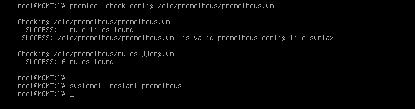

# Verification

[한국어](../../../docs/verification.md) | [English](../../en/docs/verification.md) | **日本語** | [简体中文](../../zh-CN/docs/verification.md) | [Español](../../es/docs/verification.md) | [Français](../../fr/docs/verification.md)

Configuration を最初からそのとおりに実施したとき、各章が実際にどう動くのか、そしてそれを目で確認する方法をまとめました。
コマンドの下には、正常なときに出るべき結果を書きました。`[ MGMT ]` の ansible コマンドは `/etc/ansible` で実行します。

- [章ごとの点検](#章ごとの点検)
- [障害テスト](#障害テスト)
- [セキュリティ点検](#セキュリティ点検)

## 章ごとの点検

### Basic Configuration

```bash
# [ MGMT ]
ansible all -a hostname
```
FW、DNS、WEB1、WEB2、DB、MGMT がそれぞれ自分の機器名を出力します。

### IP Configuration

FW は4つのネットワークにまたがっているため、ネットワークをまたぐすべてのトラフィックは FW を通ります。

```bash
# [ FW ]
ip -br a            # ens33 203.0.113.10 / ens37 10.10.10.254 / ens38 10.10.20.254 / ens39 10.10.30.254
# [ DB ]
ip route            # default via 10.10.20.254
# [ MGMT ]
ping -c 2 10.10.20.10     # 応答あり (MGMT 網は FW ですべて許可)
```

### IP Forwarding

```bash
# [ FW ]
sysctl net.ipv4.ip_forward     # = 1
systemctl status rc-local      # active (exited)
```
再起動後も 1 でなければなりません。障害テスト T9 で一緒に確認します。

### DHCP

```bash
# [ CLIENT ]
ip -br a ; ip route        # 10.10.30.1xx, default via 10.10.30.254
# [ REMOTE ]
ip -br a ; ip route        # 203.0.113.1xx、default なし
# [ MGMT ]
journalctl -u isc-dhcp-server | grep DHCPACK
```
REMOTE 側のログは `via 203.0.113.10` と記録されます。FW のリレーを経由してきたという印です。

### Nftables

```bash
# [ REMOTE ] VPN オフの状態
nmap -Pn 203.0.113.10          # 53, 80, 443 のみ open
# [ WEB1 ]
nmap -Pn -p 3306 10.10.20.10   # open
nmap -Pn -p 22 10.10.30.10     # filtered
```
Web サーバーが侵害されても DB の 3306 までしか行けず、管理網には入れません。
forward に icmp の許可がないため、MGMT から送ったもの以外はネットワークをまたぐ ping がブロックされます。そのためポート単位で確認します。

### Certificate Authority

```bash
# [ MGMT ]
openssl verify -CAfile /etc/ssl/RootCA.crt /etc/ssl/www.crt     # www.crt: OK
# [ CLIENT ]
curl -sI https://www.jjongmarket.kr | head -1                  # HTTP/1.1 200 (-k なしで)
```

### DNS

```bash
# [ DNS ]
named-checkconf
# [ CLIENT ]
dig www.jjongmarket.kr +short                    # 10.10.10.100
dig -x 10.10.10.21 +short                        # web1.jjong.internal.
# [ REMOTE ] VPN オフの状態
dig @203.0.113.10 www.jjongmarket.kr +short      # 203.0.113.10
dig @203.0.113.10 ns.jjong.internal              # status: REFUSED
# [ REMOTE ] VPN オンの状態
dig www.jjongmarket.kr +short                    # 10.10.10.100
```
同じ名前でも、問い合わせる場所によって答えが変わります。DNAT を経由しても送信元アドレスはそのままなので、DNS は外部からの問い合わせを区別できます。

### Wireguard

```bash
# [ REMOTE ]
nmcli connection up wg0
ip route | grep wg0              # 10.10.0.0/16, 10.8.0.0/24
ssh root@10.10.30.10 hostname    # MGMT
# [ FW ]
wg show                          # latest handshake: 数秒前
```
VPN をオフにすると、同じ ssh が `Network is unreachable` で失敗します。REMOTE は DHCP からゲートウェイを受け取らないためです。

### SSH

```bash
# [ MGMT ]
ssh-keygen -L -f /root/.ssh/id_ecdsa-cert.pub        # Key ID "jjong root key", Principals: root
ssh -i /root/.ssh/id_ecdsa root@10.10.20.10 hostname # パスワードなしで DB
```

### Chrony

```bash
# [ MGMT ]
ansible 'all:!dns' -a "chronyc sources"     # すべて ^* 10.10.10.10
# [ DNS ]
chronyc clients
```

### MariaDB

```bash
# [ DB ]
ss -lntp | grep 3306                                                           # 10.10.20.10:3306
mariadb -e "select count(*) from shop.products; select count(*) from shop.reviews"   # 160, 800
mariadb -e "show grants for 'shop'@'10.10.10.%'"
# [ WEB1 ]
ls -l /etc/jjongmarket/db.ini                                                  # -rw-r----- root www-data
```

### Backup

```bash
# [ DB ]
/usr/local/sbin/mariadb-backup.sh
ls -l /var/backups/mariadb                 # shop_日付_時刻.sql.gz, -rw-------
journalctl -t mariadb-backup -n 3          # OK
# [ MGMT ]
rsync -a --exclude '*.tmp' 10.10.20.10:/var/backups/mariadb/ /srv/backup/db/ && ls -l /srv/backup/db
```

### Keepalived

```bash
# [ WEB1, WEB2 ]
ip -br a show ens33                                   # WEB1 にのみ 10.10.10.100
journalctl -u keepalived | grep STATE | tail -2       # MASTER / BACKUP
# [ CLIENT ]
curl -s http://www.jjongmarket.kr/health.html         # WEB1
```

### WEB

```bash
# [ CLIENT ]
curl -sI http://www.jjongmarket.kr | grep -i location                                   # https://www.jjongmarket.kr/
curl -s -o /dev/null -w '%{http_code}\n' https://www.jjongmarket.kr/inc/app.php         # 403
echo | openssl s_client -connect www.jjongmarket.kr:443 2>/dev/null | openssl x509 -noout -ext subjectAltName
# [ REMOTE ] 外部の顧客として
curl -sI --resolve www.jjongmarket.kr:443:203.0.113.10 https://www.jjongmarket.kr | head -1   # 200
```
Firefox で `demo@jjongmarket.kr` でログインし、注文まで行ってみます。マイチョンに注文が表示され、時間が経つと配送ステータスが変わります。

### Streaming

```bash
# [ WEB1 ]
systemctl is-active jjonglive
grep MEDIA-SEQUENCE /var/www/hls/stream.m3u8    # 数秒後にもう一度見ると数字が増えている
# [ CLIENT ]
curl -s https://www.jjongmarket.kr/hls/stream.m3u8 | head -1    # #EXTM3U
```


### Monitoring

```bash
# [ MGMT ]
promtool check rules /etc/prometheus/rules-jjong.yml
curl -s localhost:9090/api/v1/targets | grep -o '"health":"[a-z]*"' | sort | uniq -c    # 10 "health":"up"
```



CLIENT Firefox: `http://10.10.30.10:9090/targets` すべて UP、`/alerts` すべて Inactive、`http://10.10.30.10:3000` チョンマーケット インフラ状況。

### Ansible

```bash
# [ MGMT ]
ansible all -m ping
ansible-playbook site.yml      # 2回目の実行からすべての機器で changed=0
```

## 障害テスト

CLIENT に Grafana ダッシュボードを表示したまま、1つずつ進めます。

| # | 状況 | 場所 | 方法 | 期待される結果 | 復旧 |
| --- | --- | --- | --- | --- | --- |
| T1 | Web サービス停止 | WEB1 | `systemctl stop apache2` | 数秒以内に VIP が WEB2 へ。health.html が WEB2、ログイン維持 | `systemctl start apache2` |
| T2 | Web サーバーの電源断 | WEB1 | `poweroff` | WEB2 が VIP を引き継ぎ、1分後に HostDown | VMware で起動 |
| T3 | 配信停止 | VIP を持つ WEB | `systemctl stop jjonglive` | チョンライブ「配信準備中」、LiveDown | `systemctl start jjonglive` |
| T4 | DB 停止 | DB | `systemctl stop mariadb` | ショップのエラー画面、MariaDBDown・ShopDown | `systemctl start mariadb` |
| T5 | DB 削除後に復元 | DB | 下の T5 | 商品160件を復旧 | - |
| T6 | VPN 再起動 | FW | `systemctl restart wg-quick@wg0` | REMOTE の SSH が一瞬止まってから続く | - |
| T7 | 設定のずれ | WEB2 → MGMT | `chmod 700 .../inc` → `ansible-playbook web.yml --limit web2` | プレイブックが元に戻す | - |
| T8 | ディスク不足 | MGMT | `fallocate -l 15G /tmp/fill` | DiskAlmostFull | `rm /tmp/fill` |
| T9 | 全体再起動 | MGMT | 下の T9 | すべてのサービスが自動で再起動 | - |

T1 でログインが維持されるのは、セッションが Web サーバーではなく DB に保存されているためです。

**T5. バックアップから復元** - [ DB ]

```bash
/usr/local/sbin/mariadb-backup.sh                       # まず最新のバックアップ
B=$(ls -t /var/backups/mariadb/*.sql.gz | head -1)
mariadb -e "drop database shop"                         # ショップでエラー
gunzip -c $B | mariadb
mariadb -e "select count(*) from shop.products"         # 160
```
ダンプを `--databases shop` で取得しているので、ファイル内に CREATE DATABASE が含まれています。アカウント権限は mysql DB に別途あるため、そのまま残ります。

**T9. 全体再起動** - [ MGMT ]

```bash
ansible 'all:!mgmt' -m reboot
ansible fw -a "sysctl net.ipv4.ip_forward"     # = 1 (rc.local)
ansible-playbook site.yml                      # changed=0
```

## セキュリティ点検

点検中に見つけた改善点です。

**1. SSH CA の秘密鍵がすべてのサーバーにある**
SSH の章で `/etc/ssl` を丸ごとコピーしたため、`ssh-CA/ca`(CA の秘密鍵)と `www.key` が FW、DNS、DB にも入りました。サーバーに必要なのは `ca.pub` だけです。

```bash
# [ MGMT ]
ansible 'all:!mgmt' -m file -a "path=/etc/ssl/ssh-CA/ca state=absent"
ansible 'fw:dns:db' -m file -a "path=/etc/ssl/www.key state=absent"
ansible all -m ping
```

**2. CA を経由しない鍵が追加された**
Ansible の章で `ssh-copy-id` により ed25519 の鍵を入れました。この鍵は CA の署名や有効期限がなくても接続できます。`ansible.cfg` に `private_key_file = /root/.ssh/id_ecdsa` を設定し、authorized_keys を空にするのが次の課題です。

**3. VPN をオフにした REMOTE は名前解決ができない**
DHCP は REMOTE にも DNS 10.10.10.10 を配布しますが、VPN がオフだとそのアドレスへの経路がありません。203.0.113.0 の範囲の DNS を 203.0.113.10 に変えれば、外部 view が応答するようになります。

**4. Grafana が http、デフォルトアカウント**
3000番ポートの http で公開されています。プライベート CA の証明書で https 化することを検討します。
