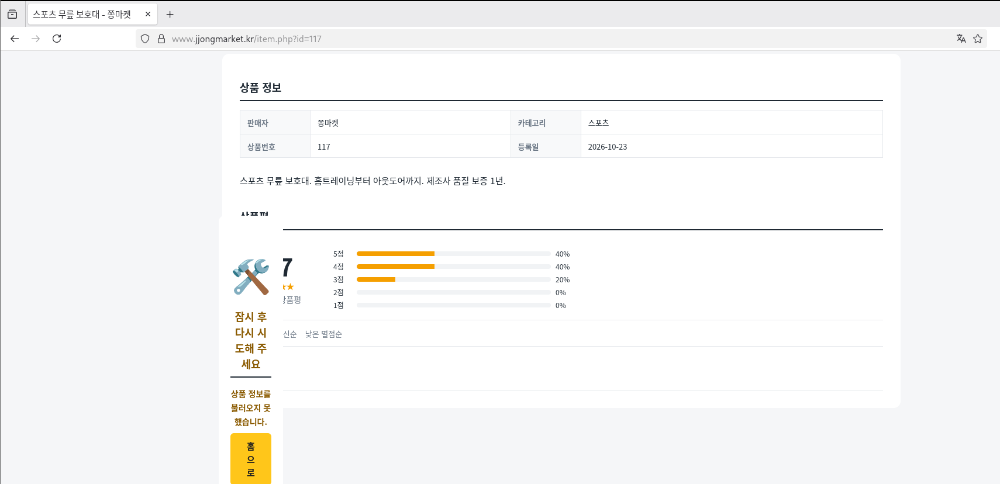
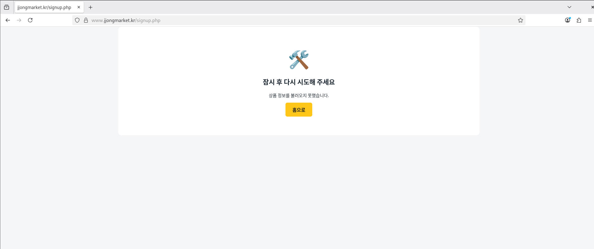
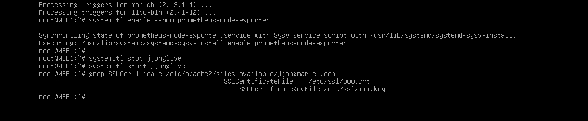

# Troubleshooting

[한국어](../../../docs/troubleshooting.md) | [English](../../en/docs/troubleshooting.md) | [日本語](../../ja/docs/troubleshooting.md) | **简体中文** | [Español](../../es/docs/troubleshooting.md) | [Français](../../fr/docs/troubleshooting.md)

这些是亲手搭建时实际卡住的问题。按症状、原因、解决的顺序记录，并附上当时截的图。

| # | 症状 | 章节 |
| --- | --- | --- |
| 1 | [商城的韩文全部显示为方块](#1-商城的韩文全部显示为方块) | WEB |
| 2 | [无法在 VMware 控制台粘贴韩文](#2-无法在-vmware-控制台粘贴韩文) | 全部 |
| 3 | [从 Notion 复制的配置中夹杂着 `<>`](#3-从-notion-复制的配置中夹杂着-) | Keepalived, WEB |
| 4 | [粘贴到 vim 后缩进像台阶一样错位](#4-粘贴到-vim-后缩进像台阶一样错位) | 全部 |
| 5 | [500 Internal Server Error](#5-500-internal-server-error) | WEB |
| 6 | [商品详情页异常，无法注册](#6-商品详情页异常无法注册) | WEB |
| 7 | [订单页输入框全部为空](#7-订单页输入框全部为空) | WEB |
| 8 | [Ansible 中除 MGMT 外全部 UNREACHABLE](#8-ansible-中除-mgmt-外全部-unreachable) | Ansible |
| 9 | [Ansible 在 WEB1 上中断 (证书路径)](#9-ansible-在-web1-上中断-证书路径) | Ansible |
| 10 | [Notion 5MB 上传限制](#10-notion-5mb-上传限制) | 资料管理 |

---

### 1. 商城的韩文全部显示为方块


- **症状**: 商城能打开，但只有韩文全部显示为方块(□)。数字、英文和服务器名 `WEB1` 正常。
- **原因**: 不是服务器的问题，而是 CLIENT(Debian GNOME)上**没有韩文字体**。HTML 以 UTF-8 正常送达，但没有可用于渲染的字体。
- **解决**: 在 CLIENT、REMOTE 上安装字体和输入法

  ```bash
  apt install -y fonts-noto-cjk ibus-hangul
  ```

- **收获**: 要先区分“乱码”是编码问题还是字体问题。如果英文和数字正常，而每个韩文字的位置正好显示一个方块，那就是字体问题。

### 2. 无法在 VMware 控制台粘贴韩文

- **症状**: 把 Prometheus 告警规则、Grafana 仪表盘 JSON 这类含韩文的配置粘贴到控制台时，韩文部分会消失或乱码。
- **原因**: VMware 控制台是模拟键盘输入的方式，不支持粘贴韩文。
- **解决**:
  - 必须包含韩文的文件(JSON、SQL)临时挂上 NAT 网卡，用 `scp` 以**文件形式**传输
  - 需要在控制台输入的配置(rules-jjong.yml 等)，把注释和文字改为英文

### 3. 从 Notion 复制的配置中夹杂着 `<>`

- **症状**: keepalived 找不到健康检查脚本，Apache 的 `RewriteRule` 行为异常。
- **原因**: Notion 会把代码块外的 URL 自动转换为链接，复制出来时变成了 `<http://127.0.0.1/health.html>` 这样带尖括号的形式。
- **解决**: 粘贴后删除 `<` `>`。`RewriteRule ^ https://...` 中的 `^` 不能删。
- **收获**: 配置一定要放在代码块里再复制。

### 4. 粘贴到 vim 后缩进像台阶一样错位

- **症状**: 粘贴 YAML、conf 时，每一行的缩进不断累加，注释(`#`)也蔓延到下一行。
- **原因**: vimrc 中的 `set si`(smartindent)把粘贴的字符当作键盘输入，进行了自动缩进。
- **解决**: 粘贴前执行 `:set paste`，结束后执行 `:set nopaste`。

### 5. 500 Internal Server Error


- **症状**: 上传商城 v2 文件后，首页返回 500。
- **排查**: 用 root 执行正常，用 Apache 用户(www-data)执行则失败。

  ```bash
  php index.php | head -5                          # 正常
  runuser -u www-data -- php index.php | head -5   # Permission denied
  ```

  

- **原因**: 从 Windows 用 `scp -r` 发送的 `inc` 文件夹权限是 `drwx------`(700)，www-data 无法打开 `inc/app.php`。

  

- **解决**:

  ```bash
  chmod -R a+rX /var/www/jjongmarket
  ```

  大写 `X` 只给文件夹加执行权限，因此文件变为 644，文件夹变为 755。
- **防止复发**: Ansible 的 `web.yml` 每次都会把文件夹改回 755。在故障测试 T7 中故意改成 700，确认能被恢复。

### 6. 商品详情页异常，无法注册

| 商品详情 | 注册 |
| --- | --- |
|  |  |

- **症状**: 商品详情页中间插入了错误框，注册时提示“请稍后再试”。
- **原因**: 没有安装 `php-mbstring`。用于韩文姓名长度检查、评价截断等的 `mb_strlen`、`mb_substr` 不存在，PHP 中途停止。
- **解决**:

  ```bash
  apt install -y php-mbstring
  systemctl restart apache2
  ```

  另外在 `inc/app.php` 中加入了没有 mbstring 时使用的替代函数，即使缺少该软件包页面也不会崩溃。
- **防止复发**: Ansible 会检查 `php-mbstring` 是否已安装。

### 7. 订单页输入框全部为空

- **症状**: 订单页(checkout)中收件人、地址本应自动填好，却全部是空白。
- **原因**: 公共头部 `header.php` 把提示信息放在 `$f` 变量里，而订单页也把输入值放在 `$f` 中。由于 include 的顺序，值被覆盖了。
- **解决**: 把 `header.php` 中的变量改名为 `$flash_msg`。
- **收获**: PHP 的 include 共享变量作用域。公共文件中应避免使用过短的变量名。

### 8. Ansible 中除 MGMT 外全部 UNREACHABLE

- **症状**: 执行 `ansible-playbook site.yml` 时只有 MGMT 为 ok，其余 5 台都是 UNREACHABLE。可是 `ssh root@10.10.10.21 hostname` 却能正常执行。
- **原因**: 手动 ssh 时，主机密钥确认(yes)和密码都是人来输入的，而 Ansible 无法进行交互式输入。
- **解决**:

  ```bash
  ssh-keyscan 10.10.30.254 10.10.10.10 10.10.10.21 10.10.10.22 10.10.20.10 >> /root/.ssh/known_hosts
  ssh-keygen -t ed25519 -N "" -f /root/.ssh/id_ed25519
  ssh-copy-id root@<各服务器>
  ```

- **遗留问题**: 这个密钥没有经过 SSH CA。参见 [Verification - 安全检查](verification.md#安全检查)。

### 9. Ansible 在 WEB1 上中断 (证书路径)


- **症状**: common.yml 在 6 台上全部成功，web.yml 在 WEB1 的 `Required files exist` 处 failed。
- **原因**: Playbook 在 `/etc/ssl/jjong/www.jjongmarket.kr.crt` 查找证书，而实际上证书在 `/etc/ssl/www.crt`。

  

- **解决**: 将 `web.yml` 和 `files/jjongmarket.conf` 中的路径改为 `/etc/ssl/www.crt`、`/etc/ssl/www.key`。
- **收获**: 如果没有这项检查，Ansible 会用指向不存在路径的 Apache 配置覆盖原配置，下次重启时商城就会宕掉。多亏 `serial: 1`，它在 WEB1 上停住，没有动 WEB2。在覆盖配置前先检查前置条件的做法发挥了作用。

### 10. Notion 5MB 上传限制

- **症状**: JJong LIVE 视频和 Grafana 软件包无法上传到 Notion Resources。
- **解决**:
  - 用 `crf 27`、`-preset veryslow`、`-tune animation` 重新编码视频，把 1 分钟压缩到 3.6MB
  - Grafana deb 按 4MB 分卷压缩后，用 `Get-FileHash` 确认合并后的文件与原文件一致
