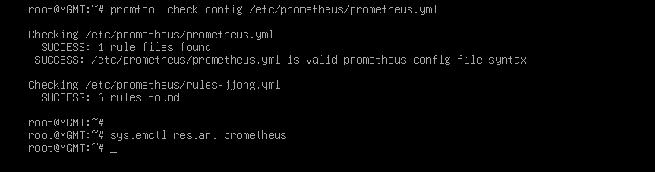

# Verification

[한국어](../../../docs/verification.md) | [English](../../en/docs/verification.md) | [日本語](../../ja/docs/verification.md) | **简体中文** | [Español](../../es/docs/verification.md) | [Français](../../fr/docs/verification.md)

整理了从头照着 Configuration 操作时，各章节实际如何运行，以及如何亲眼确认。
命令下方写出了正常时应看到的结果。`[ MGMT ]` 中的 ansible 命令在 `/etc/ansible` 中执行。

- [各章节检查](#各章节检查)
- [故障测试](#故障测试)
- [安全检查](#安全检查)

## 各章节检查

### Basic Configuration

```bash
# [ MGMT ]
ansible all -a hostname
```
FW、DNS、WEB1、WEB2、DB、MGMT 各自在本机输出自己的名称。

### IP Configuration

FW 横跨 4 个网段，所以所有跨网段的流量都经过 FW。

```bash
# [ FW ]
ip -br a            # ens33 203.0.113.10 / ens37 10.10.10.254 / ens38 10.10.20.254 / ens39 10.10.30.254
# [ DB ]
ip route            # default via 10.10.20.254
# [ MGMT ]
ping -c 2 10.10.20.10     # 有应答 (FW 对 MGMT 网段全部放行)
```

### IP Forwarding

```bash
# [ FW ]
sysctl net.ipv4.ip_forward     # = 1
systemctl status rc-local      # active (exited)
```
重启后也必须是 1。在故障测试 T9 中一起确认。

### DHCP

```bash
# [ CLIENT ]
ip -br a ; ip route        # 10.10.30.1xx, default via 10.10.30.254
# [ REMOTE ]
ip -br a ; ip route        # 203.0.113.1xx，没有 default
# [ MGMT ]
journalctl -u isc-dhcp-server | grep DHCPACK
```
REMOTE 的日志显示为 `via 203.0.113.10`，表示是经过 FW 中继过来的。

### Nftables

```bash
# [ REMOTE ] VPN 关闭状态
nmap -Pn 203.0.113.10          # 只有 53、80、443 为 open
# [ WEB1 ]
nmap -Pn -p 3306 10.10.20.10   # open
nmap -Pn -p 22 10.10.30.10     # filtered
```
即使 Web 服务器被攻破，也只能到达数据库的 3306，无法进入管理网。
forward 中没有放行 icmp，因此除了从 MGMT 发出的以外，跨网段的 ping 都会被拦截。所以按端口进行确认。

### Certificate Authority

```bash
# [ MGMT ]
openssl verify -CAfile /etc/ssl/RootCA.crt /etc/ssl/www.crt     # www.crt: OK
# [ CLIENT ]
curl -sI https://www.jjongmarket.kr | head -1                  # HTTP/1.1 200 (不加 -k)
```

### DNS

```bash
# [ DNS ]
named-checkconf
# [ CLIENT ]
dig www.jjongmarket.kr +short                    # 10.10.10.100
dig -x 10.10.10.21 +short                        # web1.jjong.internal.
# [ REMOTE ] VPN 关闭状态
dig @203.0.113.10 www.jjongmarket.kr +short      # 203.0.113.10
dig @203.0.113.10 ns.jjong.internal              # status: REFUSED
# [ REMOTE ] VPN 开启状态
dig www.jjongmarket.kr +short                    # 10.10.10.100
```
同一个名称，查询的位置不同，得到的答案也不同。经过 DNAT 后源地址仍保持不变，所以 DNS 能区分外部查询。

### Wireguard

```bash
# [ REMOTE ]
nmcli connection up wg0
ip route | grep wg0              # 10.10.0.0/16, 10.8.0.0/24
ssh root@10.10.30.10 hostname    # MGMT
# [ FW ]
wg show                          # latest handshake: 几秒前
```
关闭 VPN 后，同样的 ssh 会以 `Network is unreachable` 失败。因为 REMOTE 没有从 DHCP 获得网关。

### SSH

```bash
# [ MGMT ]
ssh-keygen -L -f /root/.ssh/id_ecdsa-cert.pub        # Key ID "jjong root key", Principals: root
ssh -i /root/.ssh/id_ecdsa root@10.10.20.10 hostname # 无需密码登录 DB
```

### Chrony

```bash
# [ MGMT ]
ansible 'all:!dns' -a "chronyc sources"     # 全部 ^* 10.10.10.10
# [ DNS ]
chronyc clients
```

### MariaDB

```bash
# [ DB ]
ss -lntp | grep 3306                                                           # 10.10.20.10:3306
mariadb -e "select count(*) from shop.products; select count(*) from shop.reviews"   # 160, 800
mariadb -e "show grants for 'shop'@'10.10.10.%'"
# [ WEB1 ]
ls -l /etc/jjongmarket/db.ini                                                  # -rw-r----- root www-data
```

### Backup

```bash
# [ DB ]
/usr/local/sbin/mariadb-backup.sh
ls -l /var/backups/mariadb                 # shop_日期_时间.sql.gz, -rw-------
journalctl -t mariadb-backup -n 3          # OK
# [ MGMT ]
rsync -a --exclude '*.tmp' 10.10.20.10:/var/backups/mariadb/ /srv/backup/db/ && ls -l /srv/backup/db
```

### Keepalived

```bash
# [ WEB1, WEB2 ]
ip -br a show ens33                                   # 只有 WEB1 上有 10.10.10.100
journalctl -u keepalived | grep STATE | tail -2       # MASTER / BACKUP
# [ CLIENT ]
curl -s http://www.jjongmarket.kr/health.html         # WEB1
```

### WEB

```bash
# [ CLIENT ]
curl -sI http://www.jjongmarket.kr | grep -i location                                   # https://www.jjongmarket.kr/
curl -s -o /dev/null -w '%{http_code}\n' https://www.jjongmarket.kr/inc/app.php         # 403
echo | openssl s_client -connect www.jjongmarket.kr:443 2>/dev/null | openssl x509 -noout -ext subjectAltName
# [ REMOTE ] 以外部顾客的身份
curl -sI --resolve www.jjongmarket.kr:443:203.0.113.10 https://www.jjongmarket.kr | head -1   # 200
```
在 Firefox 中用 `demo@jjongmarket.kr` 登录并下单。订单会出现在“我的 JJong”中，随着时间推移配送状态会变化。

### Streaming

```bash
# [ WEB1 ]
systemctl is-active jjonglive
grep MEDIA-SEQUENCE /var/www/hls/stream.m3u8    # 几秒后再看，数字会增加
# [ CLIENT ]
curl -s https://www.jjongmarket.kr/hls/stream.m3u8 | head -1    # #EXTM3U
```


### Monitoring

```bash
# [ MGMT ]
promtool check rules /etc/prometheus/rules-jjong.yml
curl -s localhost:9090/api/v1/targets | grep -o '"health":"[a-z]*"' | sort | uniq -c    # 10 "health":"up"
```



CLIENT Firefox: `http://10.10.30.10:9090/targets` 全部 UP，`/alerts` 全部 Inactive，`http://10.10.30.10:3000` JJongMarket 基础设施状态。

### Ansible

```bash
# [ MGMT ]
ansible all -m ping
ansible-playbook site.yml      # 从第二次执行起，所有设备 changed=0
```

## 故障测试

在 CLIENT 上打开 Grafana 仪表盘，逐项进行。

| # | 情况 | 位置 | 方法 | 预期结果 | 恢复 |
| --- | --- | --- | --- | --- | --- |
| T1 | Web 服务停止 | WEB1 | `systemctl stop apache2` | 几秒内 VIP 切到 WEB2。health.html 显示 WEB2，登录保持 | `systemctl start apache2` |
| T2 | Web 服务器断电 | WEB1 | `poweroff` | WEB2 接管 VIP，1 分钟后 HostDown | 在 VMware 中开机 |
| T3 | 直播中断 | 持有 VIP 的 WEB | `systemctl stop jjonglive` | JJong LIVE 显示“直播准备中”，LiveDown | `systemctl start jjonglive` |
| T4 | 数据库停止 | DB | `systemctl stop mariadb` | 商城错误页面，MariaDBDown·ShopDown | `systemctl start mariadb` |
| T5 | 删除数据库后恢复 | DB | 见下方 T5 | 恢复 160 件商品 | - |
| T6 | 重启 VPN | FW | `systemctl restart wg-quick@wg0` | REMOTE 的 SSH 短暂停顿后继续 | - |
| T7 | 配置漂移 | WEB2 → MGMT | `chmod 700 .../inc` → `ansible-playbook web.yml --limit web2` | Playbook 自动恢复 | - |
| T8 | 磁盘不足 | MGMT | `fallocate -l 15G /tmp/fill` | DiskAlmostFull | `rm /tmp/fill` |
| T9 | 全部重启 | MGMT | 见下方 T9 | 所有服务自动恢复运行 | - |

T1 中登录状态能够保持，是因为会话保存在数据库而不是 Web 服务器上。

**T5. 从备份恢复** - [ DB ]

```bash
/usr/local/sbin/mariadb-backup.sh                       # 先做一次最新备份
B=$(ls -t /var/backups/mariadb/*.sql.gz | head -1)
mariadb -e "drop database shop"                         # 商城出错
gunzip -c $B | mariadb
mariadb -e "select count(*) from shop.products"         # 160
```
转储使用了 `--databases shop`，所以文件中包含 CREATE DATABASE。账号权限单独保存在 mysql 库中，因此保持不变。

**T9. 全部重启** - [ MGMT ]

```bash
ansible 'all:!mgmt' -m reboot
ansible fw -a "sysctl net.ipv4.ip_forward"     # = 1 (rc.local)
ansible-playbook site.yml                      # changed=0
```

## 安全检查

检查过程中发现的不足之处。

**1. 所有服务器上都有 SSH CA 私钥**
在 SSH 章节中整体复制了 `/etc/ssl`，导致 `ssh-CA/ca`(CA 私钥)和 `www.key` 也进入了 FW、DNS、DB。服务器只需要 `ca.pub`。

```bash
# [ MGMT ]
ansible 'all:!mgmt' -m file -a "path=/etc/ssl/ssh-CA/ca state=absent"
ansible 'fw:dns:db' -m file -a "path=/etc/ssl/www.key state=absent"
ansible all -m ping
```

**2. 加入了不经过 CA 的密钥**
在 Ansible 章节中用 `ssh-copy-id` 加入了 ed25519 密钥。这个密钥没有 CA 签名和有效期也能登录。下一步是在 `ansible.cfg` 中设置 `private_key_file = /root/.ssh/id_ecdsa` 并清空 authorized_keys。

**3. 关闭 VPN 的 REMOTE 无法解析域名**
DHCP 也给 REMOTE 下发了 DNS 10.10.10.10，但 VPN 关闭时没有到该地址的路由。如果把 203.0.113.0 地址池的 DNS 改为 203.0.113.10，就会由外部 view 应答。

**4. Grafana 使用 http 和默认账号**
目前通过 3000 端口以 http 开放。正在考虑用私有 CA 证书启用 https。
